# ME106 Fluid Mechanics

## 1. Governing Equations 
- Navier Stokes equation
- Scalar velocity 
- Steam Function
- Flow geometry (Laplace)
- Reynolds number 
- log-polar coordinates

## 2.Steady Flows
- Finite difference method
- Successive Over relaxation equation fro 2D steady state flow govern by Laplace's equation
- Boundary Condition 
- Project: Steady flow solution for Re=10

## 3.UnSteady Flows
- Periodic Boundary Condition 
- Matrix algebra techniques
- Runge-Kutta Methods 
- Project: UnSteady flow solution for Re=60


## Concepts from Fundamentals of Fluid Mechanics (8th Ed. - Munson)

### HW1: Density,**Specific Volume, Specific Weight, Specific Gravity, Ideal Gas Law, Viscosity, Compressibility of Fluids, Bulk Modulus, Compression and Expansion of Gases, Vapor Pressure, Surface Tension
## Surface Tension: Liquis maintains a shape @ fluid fluid interface due to cohesive forces 
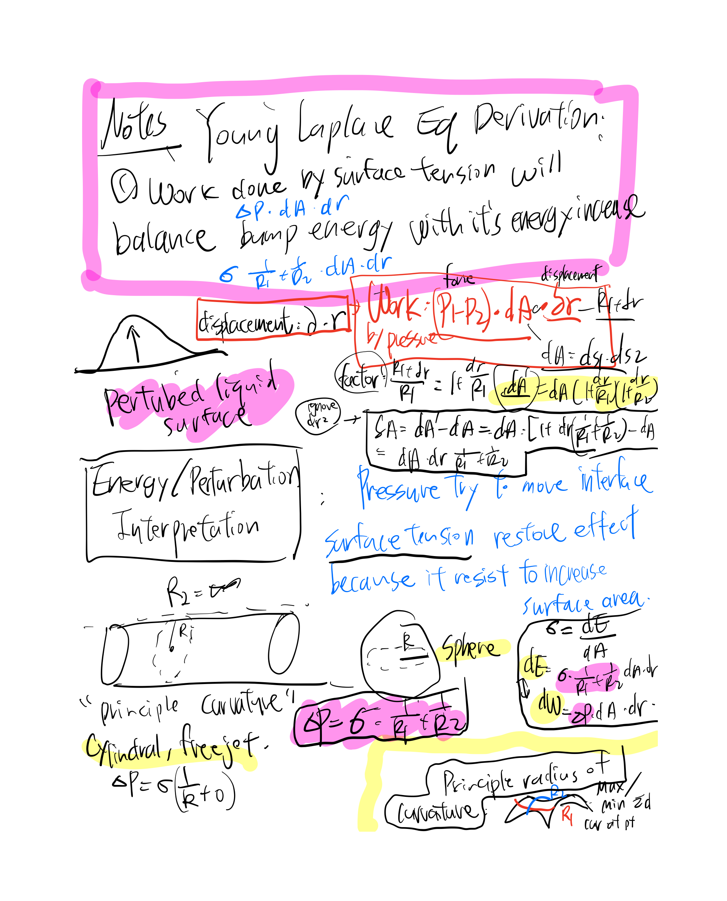
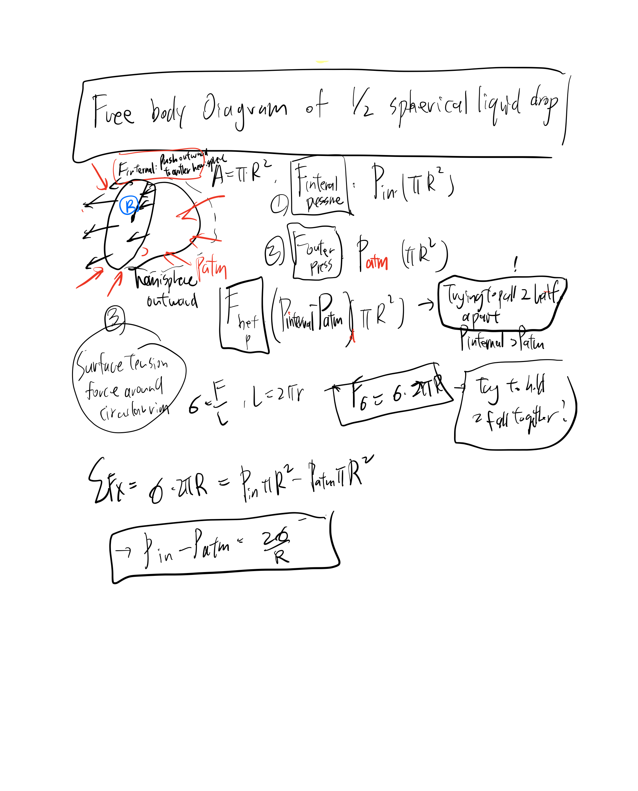


#### Viscosity Profile and Shear Stress

* **Newton's Law of Viscosity (1D flow):**
$$\tau = \mu \frac{du}{dy}$$

---

#### Surface Tension & Capillary Action

* **Young-Laplace Law (Pressure difference and curvature):**
$$\Delta P = P_{\text{inside}} - P_{\text{outside}} = \sigma \left( \frac{1}{R_1} + \frac{1}{R_2} \right)$$

* **Spherical Droplet ($R_1 = R_2 = R$):**
$$\Delta P = \frac{2\sigma}{R}$$

* **Spherical Soap Bubble (Two interfaces):**
$$\Delta P = \frac{4\sigma}{R}$$

* **Cylindrical Jet ($R_1 = R, R_2 = \infty$):**
$$\Delta P = \frac{\sigma}{R}$$

* **Capillary Effect (Height of fluid column in a tube of radius $r$):**
$$h = \frac{2\sigma \cos\theta}{\rho g r}$$

* **Water Strider Support Force Balance:**
$$F_{\text{ST}} = N \cdot L_{\text{leg}} \cdot \sigma \cos\theta$$

---

#### Free Body Diagrams, Free Jets & Concentric Cylinder Viscometer

* **Control Volume Force Balance for a Free Jet Deflected by Angle $\theta$:**
$$F_x = \dot{m}(v_{\text{in}} - v_{\text{out},x}) = \rho A v^2 (1 - \cos\theta)$$

* **Perpendicular Impact on a Flat Surface or Cylinder ($\theta = 90^\circ$ deflection):**
$$F_x = \rho A v^2$$

* **Concentric Cylinder Viscometer — Side Shear Stress (Narrow gap $\Delta r = R_o - R_i$):**
$$\tau_{\text{side}} = \mu \frac{\Omega R_i}{\Delta r}$$

* **Concentric Cylinder Viscometer — Side Torque ($T_{\text{side}}$ on inner cylinder of radius $R_i$ and height $H$):**
$$T_{\text{side}} = \tau_{\text{side}} \cdot (2\pi R_i H) \cdot R_i = \frac{2\pi \mu \Omega R_i^3 H}{\Delta r}$$

* **Concentric Cylinder Viscometer — Bottom Surface Shear Stress at radius $r$ (Bottom gap $h_b$):**
$$\tau_{\text{bottom}}(r) = \mu \frac{\Omega r}{h_b}$$

* **Concentric Cylinder Viscometer — Bottom Torque ($T_{\text{bottom}}$ integrated across bottom disk of radius $R_i$):**
$$T_{\text{bottom}} = \int_{0}^{R_i} r \cdot \left(\mu \frac{\Omega r}{h_b}\right) (2\pi r \, dr) = \frac{\pi \mu \Omega R_i^4}{2 h_b}$$

* **Total Viscous Torque ($T_{\text{total}}$):**
$$T_{\text{total}} = T_{\text{side}} + T_{\text{bottom}} = 2\pi \mu \Omega R_i^3 \left( \frac{H}{\Delta r} + \frac{R_i}{4 h_b} \right)$$
---

## W2 , W3 Fluid statics and Elementart Fluid Dynamics
## Fluid Statics - Pressure variation in a fluid at rest 
/ Bernoulli Equation
: Derivation of streamline and normal components of the momentum equation

## Look out for direction: the pressure force direction is opposite to delta P , the coordinate z has opposite direction than gravity 
$${-\nabla P+\rho\mathbf g=\rho\mathbf a}$$
$${-\frac{dP}{ds}-\rho g\frac{dz}{ds}=\rho a_s}$$
$$\[a_s=V\frac{dV}{ds}.\]$$ for steady flow 
-Here:
- \(P\): scalar pressure
- $$\(\nabla P\)$$: vector pointing toward increasing pressure
- $$\(-\nabla P\)$$: pressure-force vector per unit volume
- $$\(\mathbf g\)$$: gravity acceleration vector
- $$\(\mathbf a\)$$: fluid acceleration vector
- $$\(\rho\)$$: scalar density

- 2.1 Pascal Law - pressure at a pts in all direction are the same
- 2.2 General Equtation of liquid in motion under gravity (thought process: taylor expansion of Pressure at different points with Volume and Area of a Wedge liquid object under water)
$${\rho\left[\frac{\partial\mathbf V}{\partial t}+(\mathbf V\cdot\nabla)\mathbf V\right]=-\nabla P+\rho\mathbf g}\]$$
- 2.2.1 : Fluid Static equation  $$\nabla P=\rho\mathbf g$$ , $$\frac{\partial P}{\partial x}=0,\qquad\frac{\partial P}{\partial y}=0,\qquad\frac{\partial P}{\partial z}=-\rho g$$
- 2.2.2.1: Velocity vectors and total acceleration vector with accerlation along stream line and normal vector: $$\[{\mathbf a=\left(\frac{\partial V}{\partial t}+V\frac{\partial V}{\partial s}\right)\mathbf e_s+\frac{V^2}{R}\mathbf e_n}\]$$
- 2.2.2 : Bernouli Equation derivation 1- Euler momentum equation -> (projection along stream line ) -> streamwise momentum equation -> Bernouli Equation: $${\frac{\partial V}{\partial t}}_{\text{local acceleration}} =0\]$$ 
- 2.2.2.1: Bernouli Equation with static fluid (V=0) -> fluid static term , start from the stream line momentum equation $$[-\frac{dp}{ds}-\rho g\frac{dz}{ds}=\rho V\frac{dV}{ds}.\]$$ -> $$\[\int\frac{dp}{\rho}+\int V\,dV+\int g\,dz=0.\]$$ -> $$\[{p+\frac12\rho V^2+\rho gz=C.}$$
- 2.2.3 : Bernoulli from an energy balance, same result 
- 2.2.4 : Criteria for Bernouli equation: Inviscid , Incompressible/ constant density , Steady / dV/dt =0
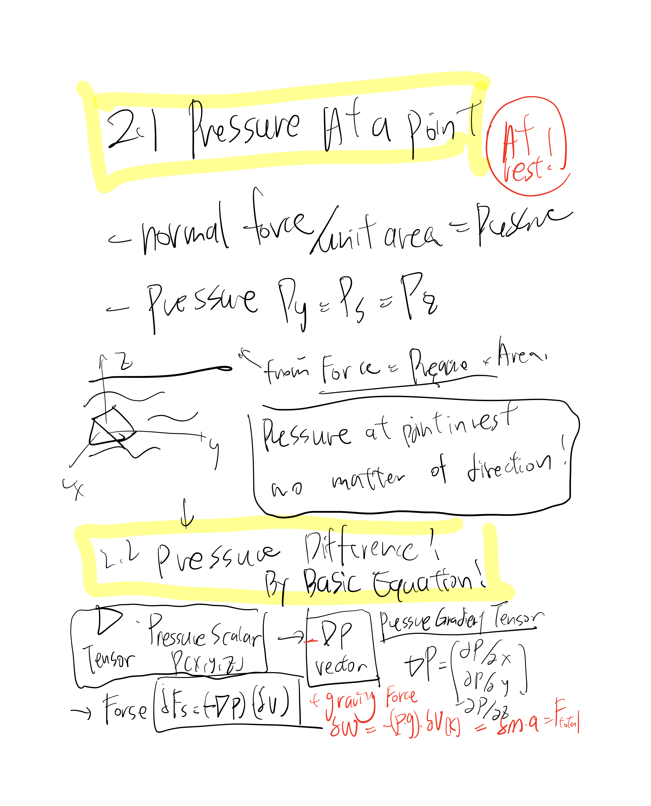
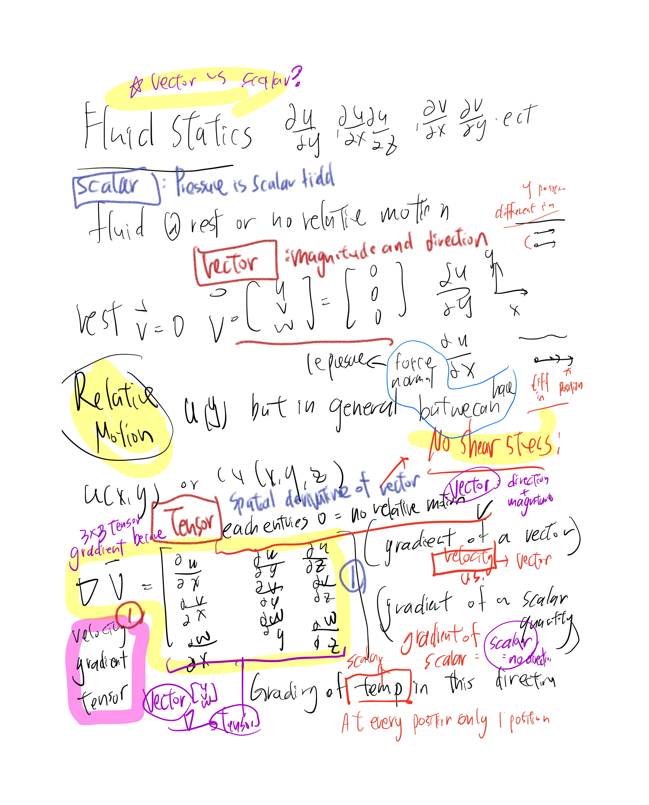
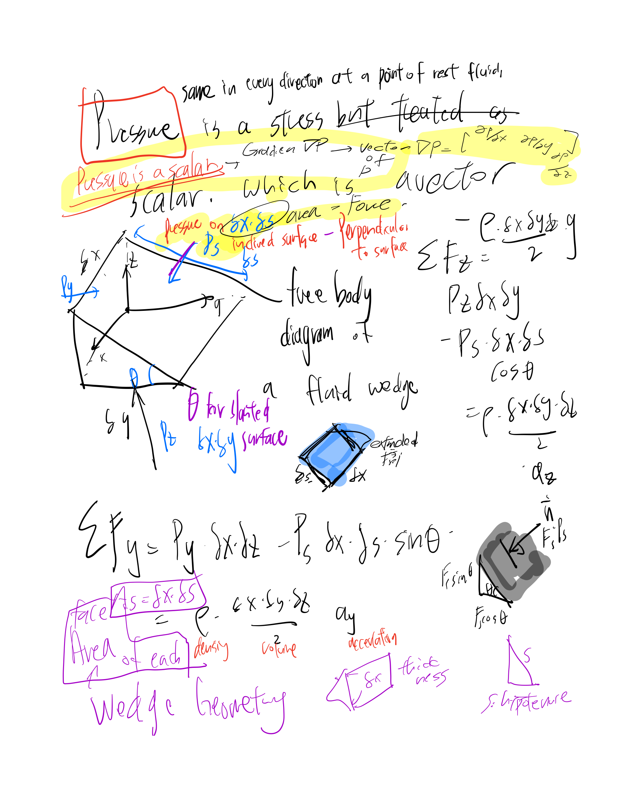
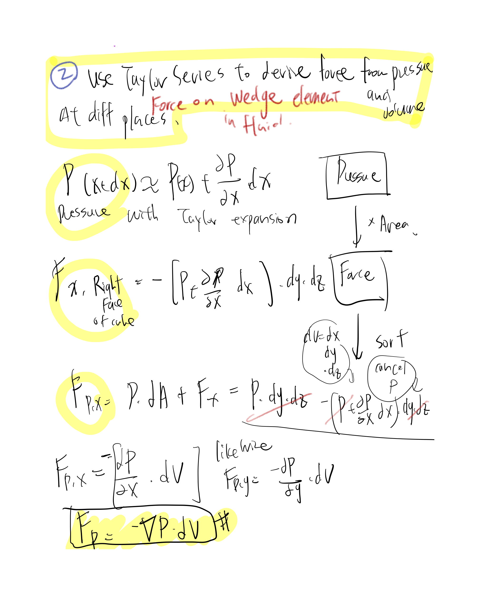
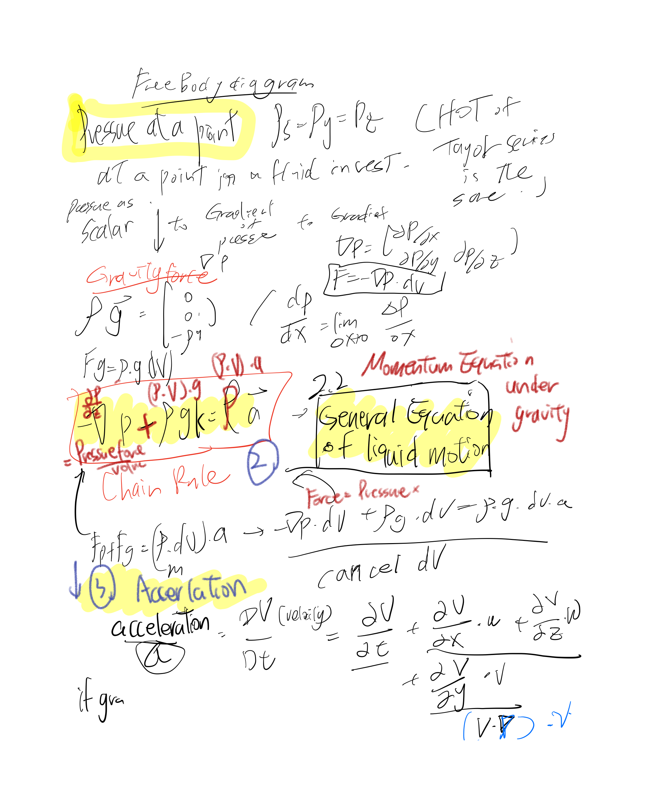
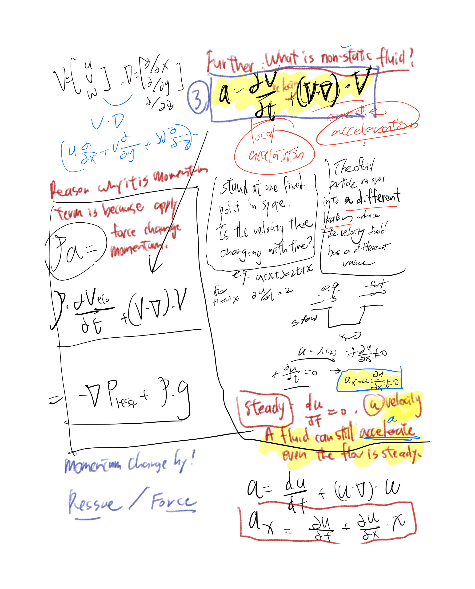
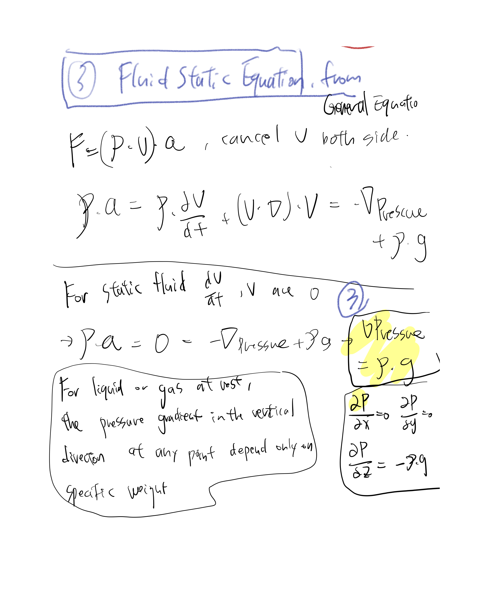
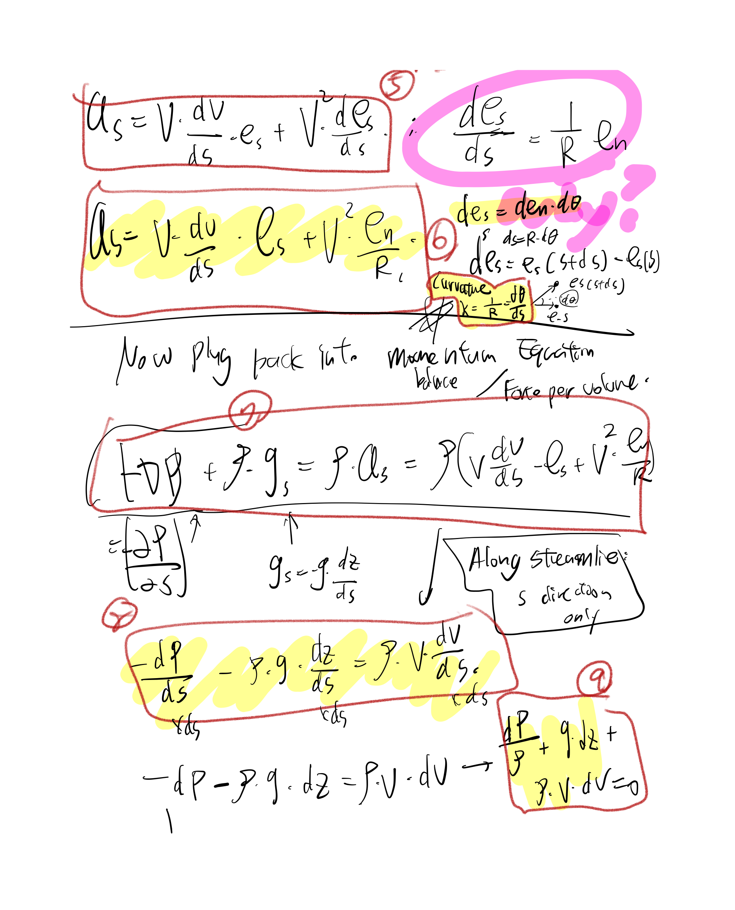
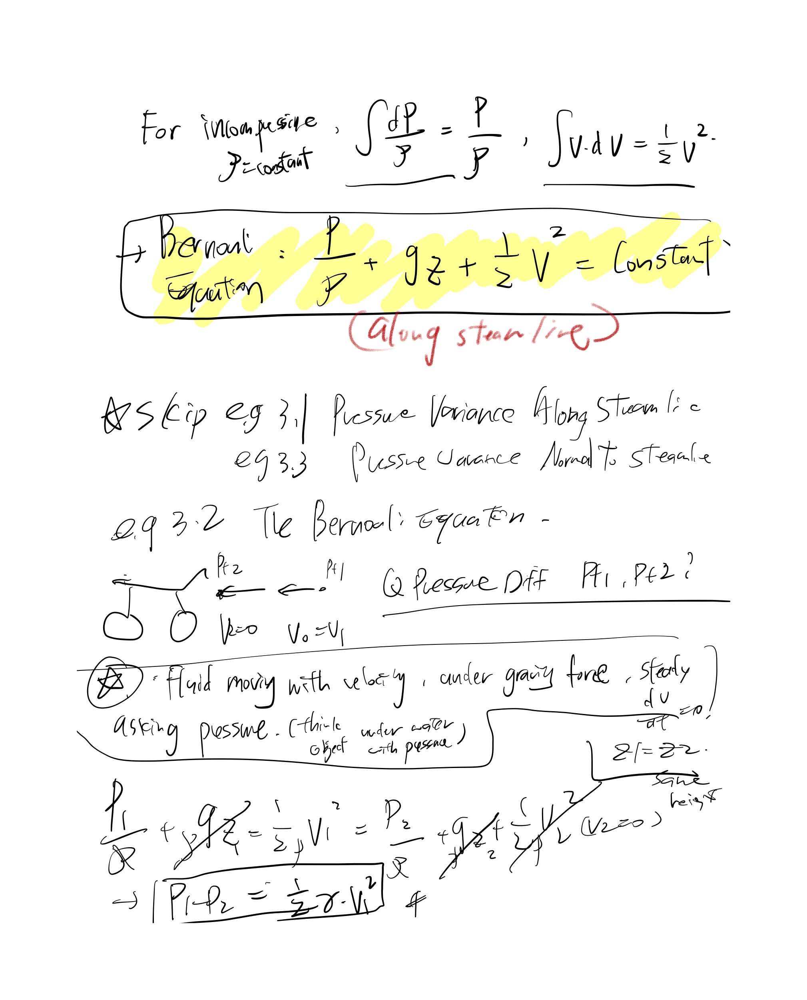
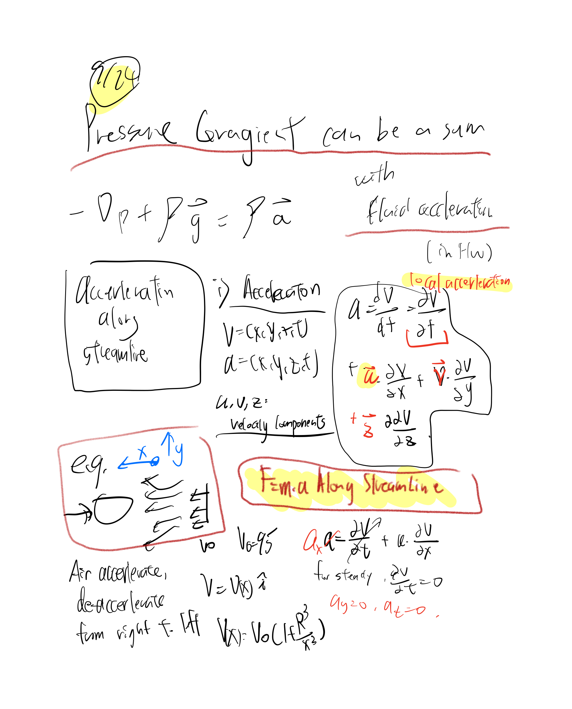


### HW2: Pressure at a pt, pressure field equation , pressure variation in a fluid a rest incompress v.s compress , manometry (piezometer, u-tube, inclined tube) , hydrostatic forece on a plane surface , pressure prism , buoyancy , flotation and stability 
- Known Manometer  Open surface with atomospheric pressure to derive connected piston pressure and force
- Question 2: If replace the constant density  by the pressure-dependent density, how to solve new Bernouli balance equation? > replace density into  conservation of momentum equation in the inviscid fluid before integration
$${\rho(P)=aP+b}$$
$$\[\int\frac{dP}{aP+b}+\int V\,dV+\int g\,dz=C.\]$$
### Q3> What pressure gradient is needed when the fluid changes speed?
### Q4> What pressure gradient is needed when the fluid changes direction?
- Question 4: normal pressure gradient (normal to the streamline) , with Different Curvature of Bended- Inner and Outer Aorta wall and normal vector of accerleration 
### HW3:


## Discussion- Different Approaches for Questions  
- Torque of Concentric-cylinder viscometer Inner cylinder (To know the torque transmitted through liquid to the inner cylinder) : Rotation -> Velocity Difference -> **Shear Stress / divide by area**-> **Shear Force** ->  Torque

# ME106 Flow Visualization Project
---

## Introduction

The goal of this project was to visualize airflow around an aircraft model and observe aerodynamic behavior that is ordinarily invisible during flight. A small aircraft model was mounted in a low-speed wind tunnel and exposed to approximately steady incoming airflow. Fog introduced upstream served as a flow tracer, making the motion of the surrounding air visible. In addition to producing an aesthetically interesting image, the experiment was intended to illustrate how the model redirects the incoming flow, alters flow near its surfaces, and potentially generates a downstream wake. The resulting image provides a qualitative basis for discussing several fundamental concepts in fluid mechanics.

---

## Methods

The experiment was conducted in a low-speed wind tunnel equipped with a viewing window. An aircraft model was mounted in the test section using a fixture that held it at a fixed position and angle of attack. The nominal freestream speed was approximately $40\text{ mph}$ ($17.9\text{ m/s}$), and the model was set to an angle of attack of $15^\circ$.

Fog was introduced upstream of the model to make portions of the airflow visible. As the fog was transported through the test section, its illuminated motion revealed changes in the flow direction around the aircraft. The image was captured with an iPhone through the tunnel's viewing window, using the available lighting to illuminate the fog. The photograph was analyzed qualitatively; it was not used to calculate local velocities or pressures.

The experimental arrangement is illustrated in Figure 1. The schematic shows the fog tube, aircraft model, supporting fixture, phone camera, and fan, as well as the model's angle of attack.

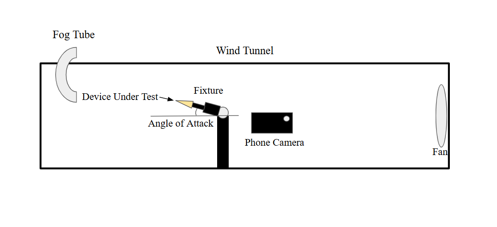  
*Figure 1: Schematic of the low-speed wind tunnel setup used for flow visualization. Fog is introduced upstream of the aircraft model, which is held at a fixed angle of attack by a fixture. A phone camera records the experiment, and a fan drives the airflow through the tunnel.*

---

## Results and Discussion

The experiment visualizes airflow around a stationary aircraft model at an approximately uniform upstream speed of $40\text{ mph}$ ($V_\infty = 17.9\text{ m/s}$) and an angle of attack of $15^\circ$. Fog introduced upstream traces selected regions of the flow around the model (Figure 2). The analysis proceeds from the characteristic flow regime (Reynolds number), to integral conservation of mass, and then to local acceleration and momentum conservation. The fog image is qualitative: it does not directly measure a local velocity field, pressure distribution, separation location, or aerodynamic force.

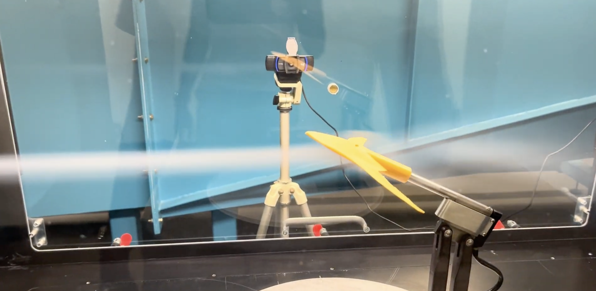  
*Figure 2: Fog visualization of the flow around a fixed aircraft model in a low-speed wind tunnel at approximately $40\text{ mph}$ and $15^\circ$ angle of attack. The visible tracer pattern indicates selected flow paths, not a measured velocity or pressure field.*

### Reynolds Number and Its Physical Significance

The chord-based Reynolds number compares characteristic inertial and viscous effects in flow around the wing:

$$Re_c = \frac{\rho V_\infty c}{\mu}$$

where $V_\infty$ is freestream speed, $c$ is the physical chord from leading to trailing edge (not its horizontal projection), $\rho$ is air density, and $\mu$ is dynamic viscosity. With measured $c = 60.2\text{ mm} = 0.0602\text{ m}$, and assumed room-temperature properties $\rho = 1.20\text{ kg/m}^3$ and $\mu = 1.81 \times 10^{-5}\text{ Pa}\cdot\text{s}$,

$$Re_c = \frac{(1.20\text{ kg/m}^3)(17.9\text{ m/s})(0.0602\text{ m})}{1.81 \times 10^{-5}\text{ Pa}\cdot\text{s}} \approx 7.14 \times 10^4$$

This Reynolds number provides a reproducible reference for the experimental condition even though the local velocity varies around the model. The large ratio indicates that inertia is important on the wing-chord scale. It does *not* imply that viscosity can be ignored in the thin boundary layer at the solid surface. At $15^\circ$ angle of attack, adverse pressure gradients may promote separation and modify the wake; the Reynolds number alone cannot determine whether or where separation, transition, or stall occurs.

### Conservation of Mass Using the Reynolds Transport Theorem

#### Why a Fixed Control Volume and Control Surface?

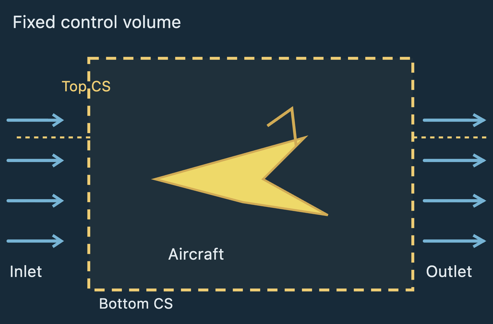  
*Figure 3: Illustrative two-dimensional section through a fixed control volume. Following every individual air particle would be inconvenient. Instead, we can choose a fixed region of space and examine the mass and momentum crossing its boundaries.*

Air passes continuously through the stationary test section. Therefore, a fixed (Eulerian) control volume (CV) is convenient: it contains air around the model while mass flows across the bounding control surface (CS). Choose an upstream cross section $A_1$ before the model, a downstream section $A_2$ containing the wake, the impermeable tunnel walls, and the impermeable aircraft surface as boundaries of the fluid CV. The outward normal vector $\mathbf{n}$ determines the sign of the flux: $\mathbf{V}\cdot\mathbf{n} < 0$ at the inlet and $\mathbf{V}\cdot\mathbf{n} > 0$ at the outlet. If the CV extends to the actual tunnel walls, there is no normal flow through those walls. The solid aircraft surface likewise has zero normal flow. Small fog injection mass is neglected.

#### Derivation from RTT

For an extensive property $B$ and specific property $b = B/m$, the Reynolds Transport Theorem for a fixed control volume is

$$\frac{dB_{\text{sys}}}{dt} = \frac{d}{dt}\int_{CV}\rho b\,dV + \int_{CS}\rho b(\mathbf{V}\cdot\mathbf{n})\,dA$$

For mass, $B = m$ and $b = 1$. Since the mass of a material system is conserved, $dm_{\text{sys}}/dt = 0$, so

$$0 = \underbrace{\frac{d}{dt}\int_{CV}\rho\,dV}_{\text{mass accumulation}} + \underbrace{\int_{CS}\rho(\mathbf{V}\cdot\mathbf{n})\,dA}_{\text{net outward mass flow}}$$

Under the additional assumption of *steady* flow through a fixed CV, the mass accumulation term is zero. Incompressibility permits density to be taken as approximately constant but, by itself, is not the reason the accumulation term vanishes. Therefore,

$$\int_{CS}\rho(\mathbf{V}\cdot\mathbf{n})\,dA = 0$$

Divide the closed CS into inlet, outlet, tunnel walls, and the aircraft surface:

$$0 = \int_{A_1}\rho(\mathbf{V}\cdot\mathbf{n})\,dA + \int_{A_2}\rho(\mathbf{V}\cdot\mathbf{n})\,dA + \underbrace{\int_{CS_{\text{walls}}}\rho(\mathbf{V}\cdot\mathbf{n})\,dA}_{=0} + \underbrace{\int_{CS_{\text{aircraft}}}\rho(\mathbf{V}\cdot\mathbf{n})\,dA}_{=0}$$

For approximately uniform incoming flow aligned with $+x$, the inlet outward normal is $-\mathbf{i}$, hence $\mathbf{V}_1\cdot\mathbf{n} = -V_\infty$. At the downstream plane $\mathbf{n} = +\mathbf{i}$, and $\mathbf{V}_2\cdot\mathbf{n} = u_2(y,z)$. Substitution gives

$$0 = -\rho V_\infty A_1 + \rho\int_{A_2}u_2(y,z)\,dA$$

or

$$\dot{m}_{\text{in}} = \rho V_\infty A_1 = \rho\int_{A_2}u_2(y,z)\,dA = \dot{m}_{\text{out}}$$

#### Conditional Mass-Flow Estimate and Its Meaning

If the reported width $W = 4.0\text{ m}$ and height $H = 1.8\text{ m}$ are the *actual flow cross-section dimensions*, and if $17.9\text{ m/s}$ is the cross-sectionally uniform inlet speed, then

$$A_1 = WH = (4.0)(1.8) = 7.2\text{ m}^2$$

$$Q_{\text{in}} = V_\infty A_1 = (17.9)(7.2) \approx 128.9\text{ m}^3\text{/s}$$

$$\dot{m}_{\text{in}} = \rho Q_{\text{in}} = (1.20)(128.9) \approx 154.7\text{ kg/s}$$

This value is *conditional*, not a verified measured flow rate. If the quoted tunnel dimensions describe the overall facility rather than the test-section air passage, the appropriate inlet area must be obtained before using this numerical result.

Even when $\dot{m}_{\text{in}} = \dot{m}_{\text{out}}$, the downstream velocity profile need not be uniform: lower streamwise velocity in a wake can be accompanied by higher velocity elsewhere in the cross section. Without a measurement of $u_2(y,z)$, the outlet profile cannot be calculated. The mass balance is nevertheless valid under its assumptions.

### Fog Streaklines, Material Derivative, and Streamline Curvature

In the Eulerian description, velocity is a field $\mathbf{V}(x,y,z,t)$, whereas the Lagrangian description follows a particle position $\mathbf{x}_p(t)$ satisfying

$$\frac{d\mathbf{x}_p}{dt} = \mathbf{V}\left(\mathbf{x}_p(t),t\right)$$

If fog is continuously released from a localized upstream source, its visible filament is a *streakline*. For ideal tracers in steady flow, streaklines, particle pathlines, and streamlines coincide; they need not coincide in unsteady wake motion.

A steady freestream does not imply zero particle acceleration. The material derivative is

$$\frac{D\mathbf{V}}{Dt} = \underbrace{\frac{\partial\mathbf{V}}{\partial t}}_{\text{local acceleration}} + \underbrace{(\mathbf{V}\cdot\nabla)\mathbf{V}}_{\text{convective acceleration}}$$

For steady, two-dimensional flow with $\mathbf{V} = u\mathbf{i} + v\mathbf{j}$,

$$\frac{Du}{Dt} = u\frac{\partial u}{\partial x} + v\frac{\partial u}{\partial y}$$

$$\frac{Dv}{Dt} = u\frac{\partial v}{\partial x} + v\frac{\partial v}{\partial y}$$

As flow turns around the aircraft, the velocity vector can change direction even without a change in speed. For a curved streamline with local radius of curvature $R$,

$$a_n = \frac{V^2}{R}$$

For locally inviscid flow away from the wall, Euler's normal momentum equation (with $n$ pointing away from the center of curvature) yields

$$\frac{\partial p}{\partial n} = \rho\frac{V^2}{R}$$

Steady, incompressible, inviscid Bernoulli flow with negligible elevation change also satisfies, *along a streamline*,

$$p + \frac{1}{2}\rho V^2 = \text{constant}$$

Thus flow turning and changes in local speed are linked to pressure gradients. However, $V(x,y,z,t)$, its spatial gradients, and the local streamline radius $R$ were not measured. Accordingly, the acceleration and pressure-gradient equations explain the qualitative physics but cannot be evaluated numerically from this photograph alone. Bernoulli's relation should not be applied uncritically across separated or strongly dissipative flow.

### Conservation of Linear Momentum and Aerodynamic Forces

Using $B = m\mathbf{V}$ and $b = \mathbf{V}$ in RTT and applying Newton's second law,

$$\sum\mathbf{F}_{\text{ext}} = \frac{d}{dt}\int_{CV}\rho\mathbf{V}\,dV + \int_{CS}\rho\mathbf{V}(\mathbf{V}\cdot\mathbf{n})\,dA$$

For steady flow in the fixed CV,

$$\sum\mathbf{F}_{\text{ext}} = \int_{CS}\rho\mathbf{V}(\mathbf{V}\cdot\mathbf{n})\,dA$$

The external forces on the *fluid* include pressure and viscous tractions, the force exerted by the aircraft on the air, and tunnel-wall forces. Unlike their zero *mass* flux, the solid surfaces can exert nonzero forces. The measured or modeled momentum-flux difference alone therefore does not generally give the aircraft force unless other contributions have been evaluated or shown negligible.

For streamwise $x$-momentum and vertical $y$-momentum, respectively,

$$\sum F_x = \int_{CS}\rho u(\mathbf{V}\cdot\mathbf{n})\,dA$$

$$\sum F_y = \int_{CS}\rho v(\mathbf{V}\cdot\mathbf{n})\,dA$$

The reaction of the fluid on the aircraft provides aerodynamic drag and lift. Under additional assumptions appropriate to a far-wake survey (including recovered static pressure, a suitable control surface, and negligible unaccounted fluxes or wall forces), drag may be approximated from a downstream momentum deficit:

$$D \approx \rho \int_{A_{\text{wake}}} u_2(y,z) \left[ V_\infty - u_2(y,z) \right] dA$$

This is *not* valid for an arbitrary measurement plane without checking those assumptions. Actual evaluation requires a spatially resolved wake velocity profile and, where relevant, pressure and surface-force corrections.

An alternative drag representation is

$$D = \frac{1}{2}\rho V_\infty^2 S C_D$$

where $S$ is the specified reference area and $C_D$ is the drag coefficient referenced to that same area. Using the present assumed air properties,

$$q_\infty = \frac{1}{2}\rho V_\infty^2 \approx 192\text{ Pa}$$

giving

$$D \approx (192\text{ Pa}) S C_D$$

For a rectangular wing with planform reference area $S = bc$, the wingspan $b$ is needed; $C_D$ is also unknown. Thus no experimental drag or lift value can be inferred from the fog photograph.

### Boundary Layer, Possible Separation, and Wake

The no-slip condition makes the air velocity equal to the fixed model's surface velocity at the wall, causing a viscous boundary layer to develop. Pressure gradients along the wing can accelerate or decelerate the external flow. If an adverse pressure gradient is sufficiently strong, the near-wall flow may separate, producing an unsteady wake with a local momentum deficit and mixing. The $15^\circ$ angle of attack and chord Reynolds number make these effects important to consider, but the photograph does not prove a particular separation point, vortex pattern, or stall condition.

### Measurement Limitations and Parameters Still Needed

| Analysis | Status | Missing information or qualification |
| :--- | :--- | :--- |
| **Chord Reynolds number** | Estimated | Uses assumed $\rho$ and $\mu$; measure temperature and pressure for refined properties. |
| **Mass flow rate** | Conditional | Verify $4.0 \times 1.8\text{ m}^2$ is the test-section flow area and verify inlet velocity uniformity. |
| **Material acceleration** | Qualitative | Local velocity field and spatial gradients; time-resolved velocities if the flow is unsteady. |
| **Streamline curvature** | Qualitative | Local velocity magnitude $V$ and radius of curvature $R$ from calibrated images or a velocity-field survey. |
| **RTT momentum, lift, drag** | Qualitative | Inlet/outlet or wake velocity profiles, pressure distributions and relevant surface forces; account for lateral fluxes. |
| **Drag-coefficient method** | Not calculable | Reference area $S$ (including missing wingspan $b$ if $S = bc$) and compatible $C_D$. |

---

## Conclusions

At an approximately $40\text{ mph}$ freestream speed and $15^\circ$ angle of attack, fog illuminated selected portions of the air moving around a fixed aircraft model. Based on an assumed room-temperature air density and viscosity, the chord Reynolds number is approximately $7.14 \times 10^4$, emphasizing the importance of inertial effects while retaining viscous boundary-layer phenomena.

The Reynolds Transport Theorem shows that, for a steady fixed control volume bounded by impermeable walls, incoming and outgoing mass flow rates are equal even when the outlet velocity is nonuniform. The material derivative relates the deflection of fluid paths to convective acceleration, and the momentum form of RTT relates changes in momentum flux and external forces to aerodynamic loading.

These equations explain what the fog visualization represents, while measured velocity profiles, curvature, pressures, wing reference area, and forces would be needed to quantify acceleration, lift, or drag.


# ME 106 Fluid Mechanics — Homework 4

## Question 5: Velocity Fields and Streamlines

### Objective

Visualize a two-dimensional velocity field and its associated streamlines using MATLAB. Derive the streamline equations analytically and evaluate whether the velocity field represents a physically plausible flow.

### 1. Given Velocity Field

The two-dimensional, steady velocity field is defined as

$$
\mathbf{V}=\langle u,v\rangle
$$

where

$$
u=Cy,\qquad v=Cx
$$

with

$$
C=0.05
$$

The computational domain is

$$
-5\leq x\leq 5,\qquad -5\leq y\leq 5.
$$

### 2. Analytical Derivation of Streamlines

A streamline is a curve whose tangent direction is aligned with the instantaneous velocity vector.

For a two-dimensional flow,

$$
\frac{dy}{dx}=\frac{v}{u}.
$$

Substituting the velocity components,

$$
\frac{dy}{dx}=\frac{Cx}{Cy}=\frac{x}{y}.
$$

Separating variables,

$$
y\,dy=x\,dx.
$$

Integrating both sides,

$$
\int y\,dy=\int x\,dx
$$

$$
\frac{y^2}{2}=\frac{x^2}{2}+K_1.
$$

Rearranging,

$$
\boxed{y^2-x^2=K}
$$

This equation describes a family of hyperbolas.

**Streamline classification:**

- **K > 0:** Hyperbolas opening upward and downward.
- **K < 0:** Hyperbolas opening leftward and rightward.
- **K = 0:** Straight-line separatrices, given by \(y=\pm x\).

### 3. MATLAB Implementation

```matlab
C = 0.05;

% Generate computational grid
[x,y] = meshgrid(-5:1:5, -5:1:5);

% Define velocity field
u = C*y;
v = C*x;

% Plot velocity vectors without autoscaling
figure;
quiver(x,y,u,v,0);
hold on;

% Define streamline starting points
s = linspace(-5,5,21);

% Seed streamlines from all four boundaries
startx = [s, s, -5*ones(size(s)), 5*ones(size(s))];
starty = [-5*ones(size(s)), 5*ones(size(s)), s, s];

% Plot streamlines
streamline(x,y,u,v,startx,starty);

% Figure formatting
xlabel('x');
ylabel('y');
axis equal;
xlim([-5 5]);
ylim([-5 5]);
grid on;
title('Velocity Field and Streamlines: u = Cy, v = Cx');
```

The MATLAB `quiver()` function visualizes the velocity vector field, while `streamline()` numerically integrates the velocity field to construct streamlines.

Setting the last argument of `quiver()` to `0` disables automatic scaling, preserving the velocity-vector magnitudes in plot coordinates.

### 4. Velocity Field Visualization

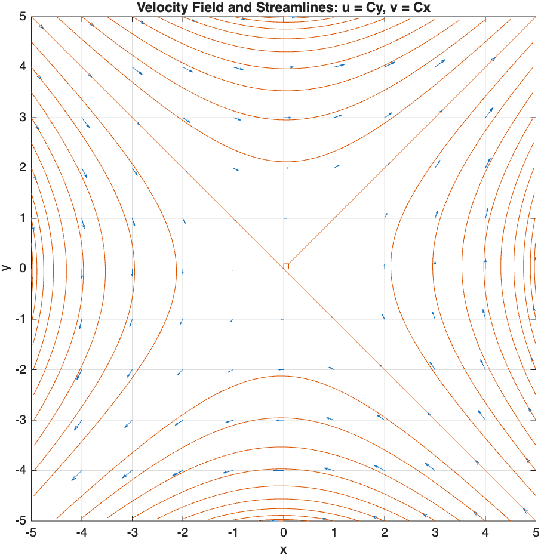

**Figure 1.** Two-dimensional velocity field and streamlines for \(u=Cy\), \(v=Cx\), with \(C=0.05\). Blue arrows represent velocity vectors, while orange curves represent streamlines.

### 5. Velocity Direction Analysis

The velocity components depend on the spatial coordinates:

$$
u=Cy,\qquad v=Cx.
$$

| Region | Horizontal Velocity (u) | Vertical Velocity (v) | Flow Direction |
|---|---|---|---|
| Quadrant I | Positive | Positive | Northeast |
| Quadrant II | Positive | Negative | Southeast |
| Quadrant III | Negative | Negative | Southwest |
| Quadrant IV | Negative | Positive | Northwest |

For example, at the location \((x,y)=(3,2)\),

$$
\mathbf V(3,2)
=\langle 0.05(2),0.05(3)\rangle
=\langle 0.10,0.15\rangle.
$$

The flow points toward the northeast.

At \((x,y)=(-3,2)\),

$$
\mathbf V(-3,2)=\langle 0.10,-0.15\rangle.
$$

The flow points toward the southeast.

### 6. Physical Interpretation

#### 6.1 Stagnation Point

At the origin,

$$
u(0,0)=0,\qquad v(0,0)=0.
$$

Therefore,

$$
\boxed{\mathbf V(0,0)=\mathbf 0}
$$

The origin is a **stagnation point**, where the local fluid velocity vanishes.

The flow approaches the stagnation point along the horizontal axis and moves away along the vertical axis.

This velocity pattern is characteristic of a two-dimensional stagnation-point flow.

#### 6.2 Continuity Equation

For a steady, incompressible fluid with constant density, conservation of mass requires

$$
\nabla\cdot\mathbf V=0.
$$

In Cartesian coordinates,

$$
\frac{\partial u}{\partial x}
+\frac{\partial v}{\partial y}=0.
$$

Substituting the given velocity components,

$$
\frac{\partial (Cy)}{\partial x}
+\frac{\partial (Cx)}{\partial y}
=0+0=0.
$$

Therefore,

$$
\boxed{\nabla\cdot\mathbf V=0}
$$

The velocity field satisfies the incompressible continuity equation.

#### 6.3 Vorticity

For a two-dimensional velocity field, the out-of-plane vorticity is

$$
\omega_z=\frac{\partial v}{\partial x}
-\frac{\partial u}{\partial y}.
$$

Substituting,

$$
\omega_z=C-C=0.
$$

Thus,

$$
\boxed{\omega_z=0}
$$

The flow is irrotational.

### 7. Conclusion

The velocity field

$$
\mathbf V=\langle Cy,Cx\rangle
$$

represents a mathematically consistent and physically plausible idealized steady incompressible flow.

Key observations:

1. The streamlines form hyperbolas described by \(y^2-x^2=K\).
2. The origin is a stagnation point.
3. Fluid approaches the origin along the horizontal axis and departs along the vertical axis.
4. The velocity field is divergence-free, satisfying incompressible mass conservation.
5. The flow has zero vorticity and is therefore irrotational.

**Overall, this velocity field is an example of a two-dimensional planar stagnation-point flow.**

## Question 5(b): Velocity Field and Streamlines for \(u=Cx^2,\; v=Cy^2\)

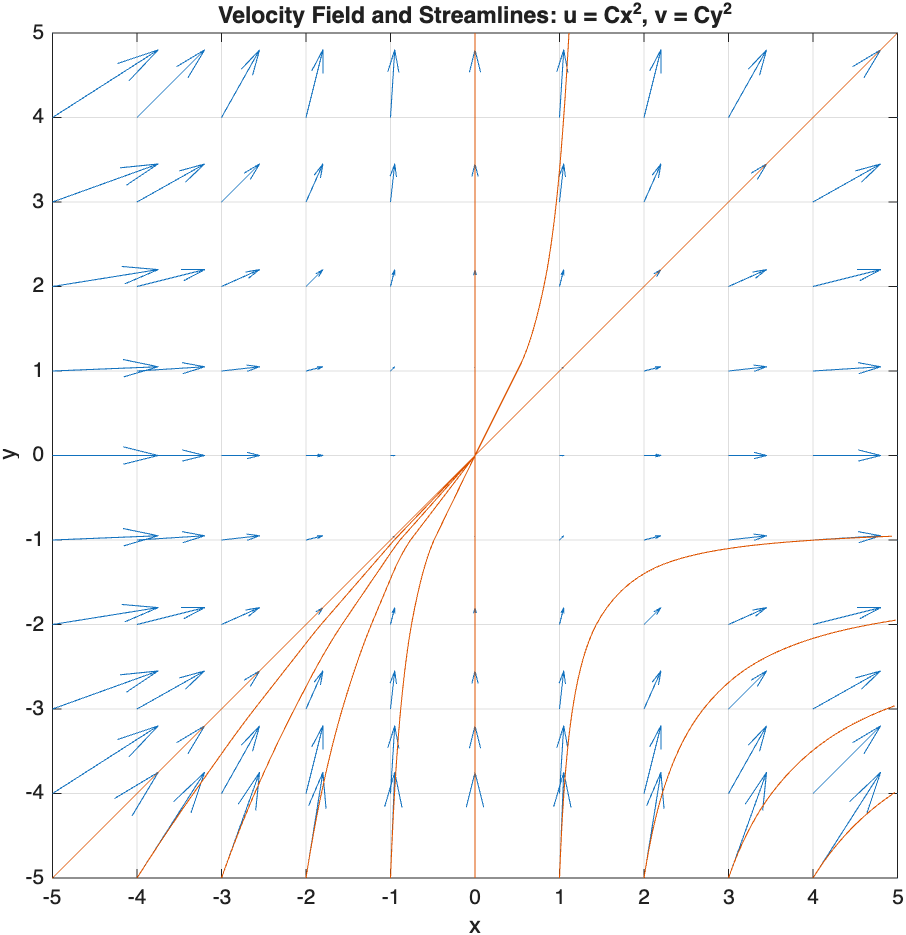


### Given Velocity Field

The two-dimensional velocity field is

$$
\mathbf{V}=\langle u,v\rangle
$$

where

$$
u=Cx^2,\qquad v=Cy^2
$$

with

$$
C=0.05.
$$

### Streamline Equation

For a streamline,

$$
\frac{dy}{dx}=\frac{v}{u}.
$$

Substituting the velocity components,

$$
\frac{dy}{dx}=\frac{Cy^2}{Cx^2}=\frac{y^2}{x^2}.
$$

Separating variables,

$$
\frac{dy}{y^2}=\frac{dx}{x^2}.
$$

Integrating,

$$
\int y^{-2}\,dy=\int x^{-2}\,dx
$$

$$
-\frac{1}{y}=-\frac{1}{x}+K
$$

which can be rewritten as

$$
\boxed{\frac{1}{y}-\frac{1}{x}=K}
$$

This is the analytical equation for the family of streamlines.

### MATLAB Code

```matlab
C = 0.05;

[x,y] = meshgrid(-5:1:5, -5:1:5);

% Velocity field
u = C*x.^2;
v = C*y.^2;

figure;
quiver(x,y,u,v,0);
hold on;

% Streamline seed points
s = linspace(-5,5,21);
startx = [s, -5*ones(size(s))];
starty = [-5*ones(size(s)), s];

streamline(x,y,u,v,startx,starty);

xlabel('x');
ylabel('y');
axis equal;
xlim([-5 5]);
ylim([-5 5]);
grid on;
title('Velocity Field and Streamlines: u = Cx^2, v = Cy^2');
```

### Interpretation of the Velocity Field

Since

$$
u=Cx^2\ge 0,\qquad v=Cy^2\ge 0,
$$

both velocity components are always nonnegative. Therefore, the flow always points to the right and upward, except at the origin where the velocity is zero.

At the origin,

$$
u(0,0)=0,\qquad v(0,0)=0,
$$

so the origin is a stagnation point.

### Why Only Part of the Streamlines May Appear

The `streamline()` function traces curves in the direction of the velocity field from the chosen seed points. Because the flow always moves to the right and upward, starting streamlines from the top boundary causes many of them to immediately leave the domain. Seeding from the bottom and left boundaries gives a more complete visualization.

### Physical Plausibility

To check whether the flow is compatible with steady incompressible constant-density flow, compute the divergence:

$$
\nabla\cdot\mathbf V
=\frac{\partial u}{\partial x}
+
\frac{\partial v}{\partial y}
=\frac{\partial (Cx^2)}{\partial x}
+
\frac{\partial (Cy^2)}{\partial y}
=2Cx+2Cy.
$$

Thus,

$$
\boxed{\nabla\cdot\mathbf V = 2C(x+y)}
$$

which is generally not zero.

Therefore, this velocity field does not satisfy the incompressible continuity equation everywhere, so it is not generally a physically plausible steady incompressible flow for a constant-density fluid.

### Conclusion

The streamline plot is consistent with the analytical relation

$$
\frac{1}{y}-\frac{1}{x}=K.
$$

The vector field correctly points to the upper right throughout the domain. However, only some streamlines are shown if seed points are chosen on just one boundary. This field is mathematically valid, but it is not generally a physically plausible incompressible flow because its divergence is not zero.

# Navier Stokes Derivation


## Ａ. 2D- netNS()
assumes planar flow, \(\mathbf V=(u,v,0)\) with no \(z\)-dependence, and has no explicit body-force term (gravity). Its pressure variable p uses a scale that puts a coefficient of one in front of the pressure gradient.

\(\lambda_1=1\) as the reference because the material derivative gives the convection term a coefficient of one. It uses \(\lambda_2=0.01\) as the reference viscous coefficient for this benchmark. In dimensional equations \(\lambda_2\) corresponds to the kinematic viscosity \(\nu=\mu/\rho\). In nondimensional equations it corresponds to \(1/\mathrm{Re}\).

| Lecture term | \(x\)-momentum in Python | \(y\)-momentum in Python |
|---|---|---|
| Local acceleration | `u_t` | `v_t` |
| Convective acceleration \((\mathbf V\cdot\nabla)\mathbf V\) | `u*u_x + v*u_y` | `u*v_x + v*v_y` |
| Pressure force in the momentum equation | `-p_x` | `-p_y` |
| Viscous diffusion in the momentum equation | `lambda_2*(u_xx + u_yy)` | `lambda_2*(v_xx + v_yy)` |


```python
        # Material acceleration. lambda_1 is fitted in this experiment.
        acceleration_x = u_t + lambda_1 * (u * u_x + v * u_y)
        acceleration_y = v_t + lambda_1 * (u * v_x + v * v_y)

        # Right-hand side of the momentum balance, with no explicit body force.
        momentum_rhs_x = -p_x + lambda_2 * (u_xx + u_yy)
        momentum_rhs_y = -p_y + lambda_2 * (v_xx + v_yy)

        # Momentum is satisfied when acceleration minus the RHS is zero.
        f_u = acceleration_x - momentum_rhs_x
        f_v = acceleration_y - momentum_rhs_y
        return u, v, p, f_u, f_v
```
```python
def net_NS(self, x, y, t):
    lambda_1 = self.lambda_1
    lambda_2 = self.lambda_2
    
    psi_and_p = self.neural_net(tf.concat([x,y,t], 1), self.weights, self.biases)
    psi = psi_and_p[:,0:1]
    p = psi_and_p[:,1:2]
    
    u = tf.gradients(psi, y)[0]
    v = -tf.gradients(psi, x)[0]  
    
    u_t = tf.gradients(u, t)[0]
    u_x = tf.gradients(u, x)[0]
    u_y = tf.gradients(u, y)[0]
    u_xx = tf.gradients(u_x, x)[0]
    u_yy = tf.gradients(u_y, y)[0]
    
    v_t = tf.gradients(v, t)[0]
    v_x = tf.gradients(v, x)[0]
    v_y = tf.gradients(v, y)[0]
    v_xx = tf.gradients(v_x, x)[0]
    v_yy = tf.gradients(v_y, y)[0]
    
    p_x = tf.gradients(p, x)[0]
    p_y = tf.gradients(p, y)[0]

    f_u = u_t + lambda_1*(u*u_x + v*u_y) + p_x - lambda_2*(u_xx + u_yy) 
    f_v = v_t + lambda_1*(u*v_x + v*v_y) + p_y - lambda_2*(v_xx + v_yy)
    
    return u, v, p, f_u, f_v
```


## B.Continuity and Fitting 


The network predicts $$\(\psi\)$$ and $$\(p\)$$. TensorFlow’s tf.gradients then differentiates those predictions to obtain velocity and the derivatives used in the residuals:
```python
u = tf.gradients(psi, y)[0]
v = -tf.gradients(psi, x)[0]
```

These definitions enforce continuity directly for a smooth $$\(\psi\)$$:
$$\[
u_x+v_y
=\frac{\partial^2\psi}{\partial x\,\partial y}
-\frac{\partial^2\psi}{\partial y\,\partial x}=0.
\]$$

So self.loss combines two velocity-data errors and two momentum residuals at the sampled training points:

$$\[
\mathcal L=\sum_n\left[
(u_{\rm obs}-u_{\rm pred})^2+
(v_{\rm obs}-v_{\rm pred})^2+
f_u^2+f_v^2\right]_n.
\]$$
One evaluation detail matters in this script. The loss only sees the spatial gradients of pressure, so adding any spatially uniform $$\(C(t)\)$$ to the predicted pressure leaves the residuals unchanged. The script compares raw pressures at snap = 100. To compare the spatial pressure fields at that snapshot, subtract each field’s spatial mean before computing the relative error:
```python
p_ref_centered = p_star - p_star.mean()
p_pred_centered = p_pred - p_pred.mean()
error_p = np.linalg.norm(p_ref_centered - p_pred_centered) / np.linalg.norm(p_ref_centered)
```
## Practice Cases
- Stagnant point for circulation
- Lift force on a half-cylinder tent


## Vector Calculus: Gradient, Divergence, and Curl

The **del operator** (∇) in 3D Cartesian coordinates is

$$
\nabla =
\mathbf{e}_x\frac{\partial}{\partial x}
+\mathbf{e}_y\frac{\partial}{\partial y}
+\mathbf{e}_z\frac{\partial}{\partial z}
$$

Let the scalar field be $f(x,y,z)$ and the vector field be

$$
\mathbf{V}(x,y,z)
=u(x,y,z)\mathbf{e}_x
+v(x,y,z)\mathbf{e}_y
+w(x,y,z)\mathbf{e}_z.
$$

### Comparison: Gradient vs. Divergence vs. Curl
### Vector Calculus, Continuity, Euler, Bernoulli, and Navier–Stokes Equations

Aim to connect vector-calculus operations to mass conservation, momentum conservation, potential flow, and numerical transport calculations. Unless otherwise indicated, use Cartesian coordinates, with velocity

$$
\mathbf{V}(x,y,z,t)=u\mathbf e_x+v\mathbf e_y+w\mathbf e_z,
\qquad \nabla=\mathbf e_x\frac{\partial}{\partial x}+\mathbf e_y\frac{\partial}{\partial y}+\mathbf e_z\frac{\partial}{\partial z}.
$$

Here $\rho$ is density, $p$ is pressure, $\mu$ is dynamic viscosity, $\nu=\mu/\rho$ is kinematic viscosity (for constant density), and $\mathbf g=-g\mathbf e_z$ when $z$ points upward.


| Operation | Input | Formula (3D Cartesian) | Del (∇) Operation | Physical Meaning |
|---|---|---|---|---|
| **Gradient** | Scalar field $f$ | $\nabla f=f_x\mathbf{e}_x+f_y\mathbf{e}_y+f_z\mathbf{e}_z$ | $\nabla f$ | Produces a **vector** pointing toward the steepest increase in the scalar field. Its magnitude is the maximum rate of increase per unit distance. Direction and magnitude of maximum spatial increase; used for pressure and temperature gradients|
| **Divergence** | Vector field $\mathbf{V}$ | $\nabla\cdot\mathbf{V}=\frac{\partial u}{\partial x}+\frac{\partial v}{\partial y}+\frac{\partial w}{\partial z}$ | $\nabla\cdot\mathbf{V}$ | Produces a **scalar** measuring local net outward flux per unit volume. For a velocity field, it measures volumetric expansion or contraction rate. |
| **Curl** | Vector field $\mathbf{V}$ | $\nabla\times\mathbf{V}=(w_y-v_z)\mathbf{e}_x+(u_z-w_x)\mathbf{e}_y+(v_x-u_y)\mathbf{e}_z$ | $\nabla\times\mathbf{V}$ | Produces a **vector** measuring local rotation. For a velocity field, this is vorticity, equal to twice the local angular rotation rate. |

Here, subscripts indicate partial derivatives, e.g.,
$f_x=\partial f/\partial x$ and $w_y=\partial w/\partial y$.

### Useful physical laws

- **Fourier's law:** $\mathbf q=-k\nabla T$ (heat conducts down the temperature gradient).
- **Fick's law:** $\mathbf J_A=-D_{AB}\nabla c_A$ (diffusive species flux down the concentration gradient, in the simple constant-$D$ model).
- **Vorticity:** $\boldsymbol\omega=\nabla\times\mathbf V$. In 2D, $\omega_z=\partial v/\partial x-\partial u/\partial y$.
- **Irrotational flow:** $\nabla\times\mathbf V=\mathbf0$, which allows a *local* velocity potential $\mathbf V=\nabla\phi$. Global single-valuedness requires additional domain conditions.

### Applications in Transport Processes

**1. Gradient — Heat Transfer**

Fourier's law:

$$
\mathbf{q}=-k\nabla T
$$

- $\nabla T$: direction of greatest temperature increase.
- $\mathbf{q}$: conductive heat flux.
- The negative sign indicates heat flows toward lower temperature.

**2. Divergence — Mass Conservation**

For constant-density incompressible flow:

$$
\nabla\cdot\mathbf{V}=0
$$

In Cartesian coordinates:

$$
\frac{\partial u}{\partial x}
+\frac{\partial v}{\partial y}
+\frac{\partial w}{\partial z}=0
$$

The net volume flux out of an infinitesimal fluid element is zero.

**3. Curl — Fluid Rotation and Vorticity**

$$
\boldsymbol{\omega}=\nabla\times\mathbf{V}
$$

For 2D flow, $w=0$ and $\partial/\partial z=0$, so

$$
\boxed{
\omega_z=
\frac{\partial v}{\partial x}
-\frac{\partial u}{\partial y}
}
$$

- $\omega_z>0$: counterclockwise local rotation.
- $\omega_z<0$: clockwise local rotation.
- $\omega_z=0$: locally irrotational flow.

### Python Implementation (NumPy)

For 3D arrays with axis order `(z, y, x)`:

```python
import numpy as np

# Scalar field gradient
dfdz, dfdy, dfdx = np.gradient(f, dz, dy, dx)

# Vector field divergence
dudz, dudy, dudx = np.gradient(u, dz, dy, dx)
dvdz, dvdy, dvdx = np.gradient(v, dz, dy, dx)
dwdz, dwdy, dwdx = np.gradient(w, dz, dy, dx)

div_V = dudx + dvdy + dwdz

# Vector field curl
curl_x = dwdy - dvdz
curl_y = dudz - dwdx
curl_z = dvdx - dudy
```

### Key Distinction

| Operation | Input → Output | Transport Example |
|---|---|---|
| Gradient | Scalar → Vector | Temperature gradient |
| Divergence | Vector → Scalar | Incompressible continuity |
| Curl | Vector → Vector | Fluid vorticity |

> **Remember:** Gradient describes how a scalar changes in space; divergence describes the net outward flux of a vector field; curl describes its local rotational tendency.

## 2. Continuity Equation — Conservation of Mass

### Integral control-volume form

$$
\boxed{\frac{d}{dt}\int_{CV}\rho\,dV+\oint_{CS}\rho\mathbf V\cdot\mathbf n\,dA=0}
$$

The first term is mass accumulation inside a fixed control volume; the second is net outward mass flow through its surface.

Using the divergence theorem,

$$
\oint_{CS}\rho\mathbf V\cdot\mathbf n\,dA
=\int_{CV}\nabla\cdot(\rho\mathbf V)\,dV.
$$

For an arbitrary fixed control volume this gives the **differential continuity equation**:

$$
\boxed{\frac{\partial\rho}{\partial t}+\nabla\cdot(\rho\mathbf V)=0}
$$

Expand with the product rule:

$$
\frac{\partial\rho}{\partial t}+\mathbf V\cdot\nabla\rho+\rho\nabla\cdot\mathbf V=0
\quad\Longleftrightarrow\quad
\boxed{\frac{D\rho}{Dt}+\rho\nabla\cdot\mathbf V=0},
$$

where $D/Dt=\partial/\partial t+\mathbf V\cdot\nabla$ is the **material derivative**.

**Constant-density incompressible flow** ($D\rho/Dt=0$, $\rho\ne0$):

$$
\boxed{\nabla\cdot\mathbf V=0}
\qquad\Longleftrightarrow\qquad
\boxed{\frac{\partial u}{\partial x}+\frac{\partial v}{\partial y}+\frac{\partial w}{\partial z}=0}.
$$

> **Important:** $\nabla\cdot\mathbf V=0$ is the kinematic incompressibility condition. A *steady* flow is not necessarily incompressible; steady means $\partial/\partial t=0$.

## 3. Euler's Equation of Motion — Inviscid Momentum Balance

Starting from the momentum balance for an inviscid fluid (neglecting viscous stresses), with gravitational body force $\rho\mathbf g$:

$$
\boxed{\rho\frac{D\mathbf V}{Dt}=-\nabla p+\rho\mathbf g}
$$

or, expanding the material derivative,

$$
\boxed{\frac{\partial\mathbf V}{\partial t}+(\mathbf V\cdot\nabla)\mathbf V=-\frac{1}{\rho}\nabla p+\mathbf g}.
$$

The left-hand side is **local acceleration + convective acceleration**. The right-hand side is **pressure force per unit mass + gravity**.

### The vector identity needed for Bernoulli

Define vorticity $\boldsymbol\omega=\nabla\times\mathbf V$. Then

$$
\boxed{(\mathbf V\cdot\nabla)\mathbf V
=\nabla\left(\frac{|\mathbf V|^2}{2}\right)-\mathbf V\times\boldsymbol\omega}
$$

(equivalently $\nabla(|\mathbf V|^2/2)+\boldsymbol\omega\times\mathbf V$).

For constant $g$ with $z$ upward, $\mathbf g=-\nabla(gz)$. Insert the identity into Euler's equation:

$$
\frac{\partial\mathbf V}{\partial t}
+\nabla\left(\frac{|\mathbf V|^2}{2}\right)
-\mathbf V\times\boldsymbol\omega
=-\frac{1}{\rho}\nabla p-\nabla(gz).
$$

For **constant density** $\rho$, group the gradients:

$$
\boxed{\frac{\partial\mathbf V}{\partial t}-\mathbf V\times\boldsymbol\omega
+\nabla\left(\frac{|\mathbf V|^2}{2}+\frac p\rho+gz\right)=\mathbf0.}
$$

## 4. Deriving Bernoulli's Equation from Euler's Vector Equation

### Step A — Assume steady flow

For $\partial\mathbf V/\partial t=\mathbf0$:

$$
\nabla B=\mathbf V\times\boldsymbol\omega,
\qquad B\equiv\frac{|\mathbf V|^2}{2}+\frac p\rho+gz.
$$

### Step B — Project along a streamline

Let $d\mathbf s$ be tangent to the local velocity, so $d\mathbf s\parallel\mathbf V$. Take the dot product with $d\mathbf s$:

$$
\nabla B\cdot d\mathbf s
=(\mathbf V\times\boldsymbol\omega)\cdot d\mathbf s=0
$$

because a cross product with $\mathbf V$ is perpendicular to $\mathbf V$.

As $\nabla B\cdot d\mathbf s=dB$ along the streamline,

$$
 dB=0
\quad\Longrightarrow\quad
\boxed{\frac{p}{\rho}+\frac{|\mathbf V|^2}{2}+gz=C_{\text{streamline}}.}
$$

Multiply by $\rho$ for the pressure form (constant $\rho$):

$$
\boxed{p+\frac12\rho|\mathbf V|^2+\rho gz=\text{constant along a streamline}.}
$$

Divide by $g$ for the **head form**:

$$
\boxed{\frac p{\rho g}+\frac{|\mathbf V|^2}{2g}+z=\text{constant along a streamline}.}
$$

### Step C — When is the Bernoulli constant the same across streamlines?

If the flow is also **irrotational** ($\boldsymbol\omega=\mathbf0$), then from $\nabla B=\mathbf V\times\boldsymbol\omega$ we have $\nabla B=\mathbf0$. Hence $B$ is constant throughout a connected flow region, not merely along each streamline.

### Assumptions / limits

| Bernoulli result | Required conditions |
|---|---|
| Along each streamline | Steady, inviscid, constant-density fluid; conservative body force (gravity here); no pumps/turbines/energy losses in the modeled region. Irrotationality **not** required. |
| Same constant throughout a connected region | Above conditions **plus irrotational flow**. |
| Unsteady irrotational version | If $\mathbf V=\nabla\phi$ locally, integration gives $\partial\phi/\partial t+|\mathbf V|^2/2+p/\rho+gz=C(t)$, with suitable potential and density assumptions. |

For a variable-density **barotropic** fluid, replace $p/\rho$ in the gradient integration by the pressure enthalpy integral $\int dp/\rho(p)$; $p/\rho$ is appropriate for constant density.

## 5. Navier–Stokes Equation — Viscous Momentum Balance

The Cauchy momentum equation is

$$
\boxed{\rho\frac{D\mathbf V}{Dt}=\nabla\cdot\boldsymbol\sigma+\rho\mathbf g},
\qquad\boldsymbol\sigma=-p\mathbf I+\boldsymbol\tau.
$$

For an incompressible Newtonian fluid with **constant dynamic viscosity** $\mu$:

$$
\boldsymbol\tau=2\mu\mathbf E,
\qquad\mathbf E=\frac12\left(\nabla\mathbf V+(\nabla\mathbf V)^T\right).
$$

Using $\nabla\cdot\mathbf V=0$ yields

$$
\boxed{\rho\left[\frac{\partial\mathbf V}{\partial t}+(\mathbf V\cdot\nabla)\mathbf V\right]
=-\nabla p+\mu\nabla^2\mathbf V+\rho\mathbf g.}
$$

Equivalently, dividing by $\rho$ (constant density):

$$
\boxed{\frac{\partial\mathbf V}{\partial t}+(\mathbf V\cdot\nabla)\mathbf V
=-\frac1\rho\nabla p+\nu\nabla^2\mathbf V+\mathbf g.}
$$

**In Cartesian components**, the $x$-momentum equation is

$$
\rho\left(\frac{\partial u}{\partial t}+u\frac{\partial u}{\partial x}+v\frac{\partial u}{\partial y}+w\frac{\partial u}{\partial z}\right)
=-\frac{\partial p}{\partial x}+\mu\left(\frac{\partial^2u}{\partial x^2}+\frac{\partial^2u}{\partial y^2}+\frac{\partial^2u}{\partial z^2}\right)+\rho g_x.
$$

The $y$- and $z$-momentum equations are obtained by replacing $u,x,g_x$ with $v,y,g_y$ or $w,z,g_z$, respectively, and retaining all three convective derivatives.

### Euler vs. Navier–Stokes vs. Bernoulli

| Equation | Main role | Viscosity | What is solved / predicted? |
|---|---|---|---|
| **Continuity** | Conservation of mass | Not explicit | Density/velocity constraints |
| **Euler** | Conservation of momentum for inviscid fluid | Neglected | Velocity and pressure fields |
| **Navier–Stokes** | Conservation of momentum with viscosity | Included | Velocity and pressure fields, boundary layers |
| **Bernoulli** | First integral of Euler along a streamline under its assumptions | Neglected | Relation among pressure, speed, and elevation |

## 6. Links to Potential Flow and Numerical Calculations

If $\nabla\times\mathbf V=\mathbf0$ locally, define a velocity potential $\mathbf V=\nabla\phi$. For an incompressible region:

$$
\nabla\cdot\mathbf V=0
\quad\Longrightarrow\quad
\boxed{\nabla^2\phi=0}.
$$

For a 2D incompressible flow, define a stream function:

$$
\boxed{u=\frac{\partial\psi}{\partial y},\qquad v=-\frac{\partial\psi}{\partial x}.}
$$

Its out-of-plane vorticity is

$$
\boxed{\omega_z=\frac{\partial v}{\partial x}-\frac{\partial u}{\partial y}=-\nabla^2\psi.}
$$

### Python: numerical divergence, gradient, and curl

```python
import numpy as np

# Grid arrays use axis order (z, y, x), with uniform spacings dz, dy, dx.
# f, u, v, w must all have the same 3D shape.

dfdz, dfdy, dfdx = np.gradient(f, dz, dy, dx, edge_order=2)
grad_f = (dfdx, dfdy, dfdz)

dudz, dudy, dudx = np.gradient(u, dz, dy, dx, edge_order=2)
dvdz, dvdy, dvdx = np.gradient(v, dz, dy, dx, edge_order=2)
dwdz, dwdy, dwdx = np.gradient(w, dz, dy, dx, edge_order=2)

divergence = dudx + dvdy + dwdz
curl_x = dwdy - dvdz
curl_y = dudz - dwdx
curl_z = dvdx - dudy
```

These NumPy derivatives are numerical approximations. On a sufficiently smooth uniformly spaced grid, `np.gradient` uses second-order central differences at interior points; with `edge_order=2`, it uses second-order one-sided stencils at boundaries.

---

## 7. Python Grid Setup for the Taylor–Green Vortex (CHMENG 250 Homework 2)

Before evaluating velocity, divergence, vorticity, or temperature gradients, create a **uniform two-dimensional Cartesian grid**:

```python
import numpy as np

L = 2.0                 # Half-width of the domain (not the full width)
U0 = 1.0                # Characteristic velocity scale
N = 101                 # Grid points along EACH axis
x = np.linspace(-L, L, N)
y = np.linspace(-L, L, N)
X, Y = np.meshgrid(x, y)
dx = x[1] - x[0]
dy = y[1] - y[0]
```

### 7.1 Line-by-line explanation

| Python expression | Meaning | Value / resulting shape |
|---|---|---|
| `L = 2.0` | Domain extends from $-L$ to $+L$ along both axes | $-2 \le x,y \le 2$; full width $2L=4$ |
| `U0 = 1.0` | Velocity amplitude used in the Taylor–Green equations | $U_0=1$ (units depend on the model) |
| `N = 101` | Number of nodes **per coordinate direction**, including endpoints | $101$ nodes per axis |
| `np.linspace(-L, L, N)` | Creates equally spaced 1D coordinates from $-L$ through $+L$ | `x.shape == y.shape == (101,)` |
| `np.meshgrid(x, y)` | Converts the 1D coordinate arrays into a 2D Cartesian grid (default `indexing='xy'`) | `X.shape == Y.shape == (101, 101)` |
| `x[1] - x[0]` | Horizontal spacing between adjacent nodes | $\Delta x=0.04$ |
| `y[1] - y[0]` | Vertical spacing between adjacent nodes | $\Delta y=0.04$ |

The spacing uses $N-1$ **intervals** between $N$ nodes:

$$
\boxed{\Delta x=\Delta y=\frac{(+L)-(-L)}{N-1}
=\frac{2L}{N-1}=\frac{4}{100}=0.04.}
$$

Thus the grid contains $101\times101=10{,}201$ nodes, whereas each coordinate direction contains $100$ intervals.

### 7.2 `linspace` versus `meshgrid`

`np.linspace(start, stop, num)` constructs **one-dimensional** coordinates, including both endpoints by default. To see how `meshgrid` works, use a smaller illustrative example:

```python
x_small = np.array([-2, 0, 2])
y_small = np.array([-2, 0, 2])
X_small, Y_small = np.meshgrid(x_small, y_small)

print(X_small)
# [[-2  0  2]
#  [-2  0  2]
#  [-2  0  2]]

print(Y_small)
# [[-2 -2 -2]
#  [ 0  0  0]
#  [ 2  2  2]]
```

The two arrays together store the coordinates of each grid node:

$$
\boxed{(X[j,i],\,Y[j,i])=(x[i],\,y[j]).}
$$

**NumPy array convention:** with default `meshgrid` indexing, axis 0 (rows, index `j`) corresponds to $y$ and axis 1 (columns, index `i`) corresponds to $x$. In other words, a field sampled at the grid points is indexed as `field[j, i]`.

### 7.3 Evaluate the Taylor–Green velocity everywhere

The prescribed velocity field is

$$
\begin{aligned}
u(x,y)&=U_0\sin\left(\frac{\pi x}{L}\right)\cos\left(\frac{\pi y}{L}\right),\\
v(x,y)&=-U_0\cos\left(\frac{\pi x}{L}\right)\sin\left(\frac{\pi y}{L}\right).
\end{aligned}
$$

```python
u = U0 * np.sin(np.pi * X / L) * np.cos(np.pi * Y / L)
v = -U0 * np.cos(np.pi * X / L) * np.sin(np.pi * Y / L)

print(X.shape, Y.shape)   # (101, 101) (101, 101)
print(u.shape, v.shape)   # (101, 101) (101, 101)
```

NumPy **vectorizes** the sine, cosine, and arithmetic operations: they run elementwise over all $10{,}201$ nodes, so no explicit Python `for` loop is necessary.

### 7.4 Why the spacings `dx` and `dy` matter

Central finite differences approximate a partial derivative using neighbors on both sides of an **interior** grid node:

$$
\left.\frac{\partial u}{\partial x}\right|_{i,j}
\approx\frac{u_{i+1,j}-u_{i-1,j}}{2\Delta x},
\qquad
\left.\frac{\partial v}{\partial y}\right|_{i,j}
\approx\frac{v_{i,j+1}-v_{i,j-1}}{2\Delta y}.
$$

In NumPy, rows correspond to $y$ and columns to $x$:

```python
dudx_num = (u[1:-1, 2:] - u[1:-1, :-2]) / (2 * dx)
dvdy_num = (v[2:, 1:-1] - v[:-2, 1:-1]) / (2 * dy)
div_num = dudx_num + dvdy_num

print(dudx_num.shape)   # (99, 99)
print(dvdy_num.shape)   # (99, 99)
print(div_num.shape)    # (99, 99)
```

- `1:-1`: select interior rows or columns, leaving out boundary nodes.
- `2:` and `:-2`: select the right- and left-shifted neighboring columns, respectively.
- `2:, 1:-1` and `:-2, 1:-1`: select neighboring rows above and below.
- The denominator is **`2 * dx`** (or `2 * dy`) because the two sampled neighbors are two grid intervals apart.
- Output size is $(N-2)\times(N-2)=(99,99)$, since central differences cannot use the outermost nodes without additional boundary formulas.

For this smooth field, the central-difference truncation error at interior points is $O(\Delta x^2)$ or $O(\Delta y^2)$, meaning the leading error is approximately four times smaller when the spacing is halved.

### 7.5 Grid resolution versus computational cost

| `N` | Nodes in 2D (`N**2`) | $\Delta x=\Delta y=4/(N-1)$ |
|---:|---:|---:|
| 11 | 121 | 0.4 |
| 21 | 441 | 0.2 |
| 51 | 2,601 | 0.08 |
| 101 | 10,201 | 0.04 |
| 201 | 40,401 | 0.02 |

Increasing `N` reduces grid spacing and generally improves the accuracy of finite differences for smooth fields, but costs more memory and computation. For a square 2D grid, the number of nodes grows as $N^2$.

**Workflow summary:** define the domain $\to$ construct 1D coordinates $\to$ create the 2D grid $\to$ evaluate velocity/temperature arrays $\to$ approximate spatial derivatives.

---
## Part 1 — Velocity Field and Streamlines

We use the **Taylor–Green vortex**:

$$u = U_0 \sin(\pi x/L)\cos(\pi y/L), \quad v = -U_0 \cos(\pi x/L)\sin(\pi y/L)$$

This field is an exact **steady solution of the incompressible Euler equations**: its convective acceleration is a pure gradient, which the pressure field absorbs. It is *not* a steady solution of Navier–Stokes, since $\nu\nabla^2\mathbf{u} = -2\nu(\pi/L)^2\mathbf{u} \neq 0$; the Navier–Stokes solution is this field multiplied by the decay factor $e^{-2\nu\pi^2 t/L^2}$. Everything below is evaluated at a single instant, so the distinction does not affect the computation — but it does matter for what the field *is*.

### 1a: Define the velocity field and verify $\nabla \cdot \mathbf{u} = 0$

Evaluate $u$ and $v$ on the meshgrid. Then compute $\partial u/\partial x$ and $\partial v/\partial y$ **analytically** (by hand, then code the result) and confirm that their sum vanishes. This is the incompressibility constraint — it must hold for any physically realizable flow of a constant-density fluid.

```python
# TODO: Define u and v on the grid
u = U0 * np.sin(np.pi * X / L) * np.cos(np.pi * Y / L)
v = -U0 * np.cos(np.pi * X / L) * np.sin(np.pi * Y / L)

# TODO: Compute du/dx and dv/dy analytically, then check divergence = 0
dudx = (U0 * np.pi / L) * np.cos(np.pi * X / L) * np.cos(np.pi * Y / L)
dvdy = -(U0 * np.pi / L) * np.cos(np.pi * X / L) * np.cos(np.pi * Y / L)
div = dudx + dvdy

print(f"Max |div(u)|: {np.max(np.abs(div)):.2e}")

#Max |div(u)|: 0.00e+00
```

## HW8,9, Midterm3, Buckingham pi theorem
- Stagnation point for circulation
- The upward lift force on a cylindrical (tunnel) tent caused by a pressure difference between the air inside the tent and the fast-moving air flowing over the outside.


