# ME106 Fluid Mechanics

## 1. Governing Equations 
- Navier Stokes equation
- Scalar velocity 
- Steam Function
- Flow geometry (Laplace)
- Reynolds number 
- log-polar coordinates

## 2.Steady Flows
- Finite difference method
- Successive Over relaxation equation fro 2D steady state flow govern by Laplace's equation
- Boundary Condition 
- Project: Steady flow solution for Re=10

## 3.UnSteady Flows
- Periodic Boundary Condition 
- Matrix algebra techniques
- Runge-Kutta Methods 
- Project: UnSteady flow solution for Re=60

## Concepts from Fundamentals of Fluid Mechanics (8th Ed. - Munson)

### HW1: Density,**Specific Volume, Specific Weight, Specific Gravity, Ideal Gas Law, Viscosity, Compressibility of Fluids, Bulk Modulus, Compression and Expansion of Gases, Vapor Pressure, Surface Tension
## Surface Tension: Liquis maintains a shape @ fluid fluid interface due to cohesive forces 
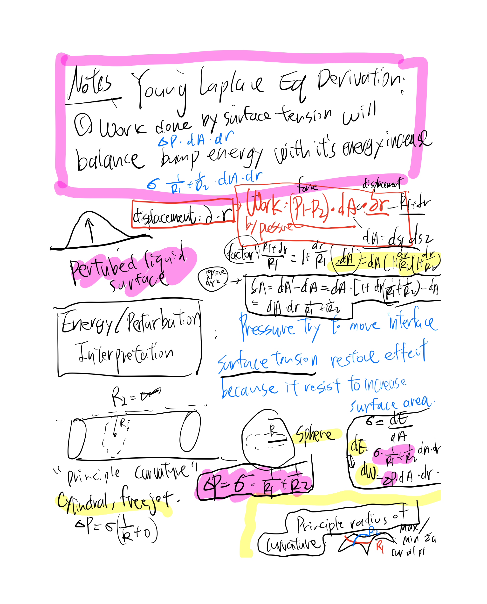
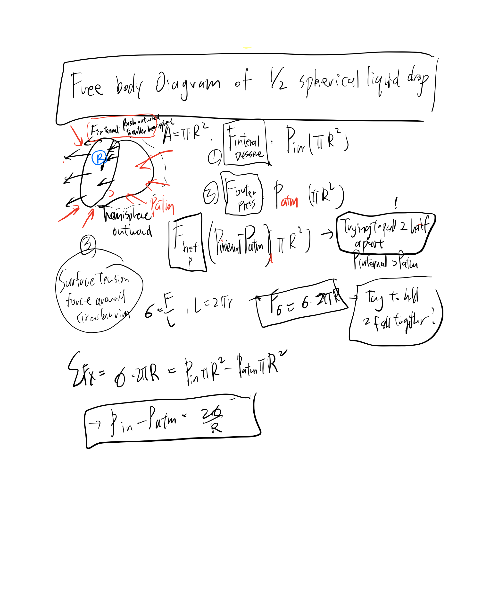

#### Viscosity Profile and Shear Stress

* **Newton's Law of Viscosity (1D flow):**
$$\tau = \mu \frac{du}{dy}$$

---

#### Surface Tension & Capillary Action

* **Young-Laplace Law (Pressure difference and curvature):**
$$\Delta P = P_{\text{inside}} - P_{\text{outside}} = \sigma \left( \frac{1}{R_1} + \frac{1}{R_2} \right)$$

* **Spherical Droplet ($R_1 = R_2 = R$):**
$$\Delta P = \frac{2\sigma}{R}$$

* **Spherical Soap Bubble (Two interfaces):**
$$\Delta P = \frac{4\sigma}{R}$$

* **Cylindrical Jet ($R_1 = R, R_2 = \infty$):**
$$\Delta P = \frac{\sigma}{R}$$

* **Capillary Effect (Height of fluid column in a tube of radius $r$):**
$$h = \frac{2\sigma \cos\theta}{\rho g r}$$

* **Water Strider Support Force Balance:**
$$F_{\text{ST}} = N \cdot L_{\text{leg}} \cdot \sigma \cos\theta$$

---

#### Free Body Diagrams, Free Jets & Concentric Cylinder Viscometer

* **Control Volume Force Balance for a Free Jet Deflected by Angle $\theta$:**
$$F_x = \dot{m}(v_{\text{in}} - v_{\text{out},x}) = \rho A v^2 (1 - \cos\theta)$$

* **Perpendicular Impact on a Flat Surface or Cylinder ($\theta = 90^\circ$ deflection):**
$$F_x = \rho A v^2$$

* **Concentric Cylinder Viscometer — Side Shear Stress (Narrow gap $\Delta r = R_o - R_i$):**
$$\tau_{\text{side}} = \mu \frac{\Omega R_i}{\Delta r}$$

* **Concentric Cylinder Viscometer — Side Torque ($T_{\text{side}}$ on inner cylinder of radius $R_i$ and height $H$):**
$$T_{\text{side}} = \tau_{\text{side}} \cdot (2\pi R_i H) \cdot R_i = \frac{2\pi \mu \Omega R_i^3 H}{\Delta r}$$

* **Concentric Cylinder Viscometer — Bottom Surface Shear Stress at radius $r$ (Bottom gap $h_b$):**
$$\tau_{\text{bottom}}(r) = \mu \frac{\Omega r}{h_b}$$

* **Concentric Cylinder Viscometer — Bottom Torque ($T_{\text{bottom}}$ integrated across bottom disk of radius $R_i$):**
$$T_{\text{bottom}} = \int_{0}^{R_i} r \cdot \left(\mu \frac{\Omega r}{h_b}\right) (2\pi r \, dr) = \frac{\pi \mu \Omega R_i^4}{2 h_b}$$

* **Total Viscous Torque ($T_{\text{total}}$):**
$$T_{\text{total}} = T_{\text{side}} + T_{\text{bottom}} = 2\pi \mu \Omega R_i^3 \left( \frac{H}{\Delta r} + \frac{R_i}{4 h_b} \right)$$
---

## W2 , W3 Fluid statics and Elementart Fluid Dynamics
## Fluid Statics - Pressure variation in a fluid at rest 
/ Bernoulli Equation
: Derivation of streamline and normal components of the momentum equation

## Look out for direction: the pressure force direction is opposite to delta P , the coordinate z has opposite direction than gravity 
$${-\nabla P+\rho\mathbf g=\rho\mathbf a}$$
$${-\frac{dP}{ds}-\rho g\frac{dz}{ds}=\rho a_s}$$
$$\[a_s=V\frac{dV}{ds}.\]$$ for steady flow 
-Here:
- \(P\): scalar pressure
- $$\(\nabla P\)$$: vector pointing toward increasing pressure
- $$\(-\nabla P\)$$: pressure-force vector per unit volume
- $$\(\mathbf g\)$$: gravity acceleration vector
- $$\(\mathbf a\)$$: fluid acceleration vector
- $$\(\rho\)$$: scalar density

- 2.1 Pascal Law - pressure at a pts in all direction are the same
- 2.2 General Equtation of liquid in motion under gravity (thought process: taylor expansion of Pressure at different points with Volume and Area of a Wedge liquid object under water)
$${\rho\left[\frac{\partial\mathbf V}{\partial t}+(\mathbf V\cdot\nabla)\mathbf V\right]=-\nabla P+\rho\mathbf g}\]$$
- 2.2.1 : Fluid Static equation  $$\nabla P=\rho\mathbf g$$ , $$\frac{\partial P}{\partial x}=0,\qquad\frac{\partial P}{\partial y}=0,\qquad\frac{\partial P}{\partial z}=-\rho g$$
- 2.2.2.1: Velocity vectors and total acceleration vector with accerlation along stream line and normal vector: $$\[{\mathbf a=\left(\frac{\partial V}{\partial t}+V\frac{\partial V}{\partial s}\right)\mathbf e_s+\frac{V^2}{R}\mathbf e_n}\]$$
- 2.2.2 : Bernouli Equation derivation 1- Euler momentum equation -> (projection along stream line ) -> streamwise momentum equation -> Bernouli Equation: $${\frac{\partial V}{\partial t}}_{\text{local acceleration}} =0\]$$ 
- 2.2.2.1: Bernouli Equation with static fluid (V=0) -> fluid static term , start from the stream line momentum equation $$[-\frac{dp}{ds}-\rho g\frac{dz}{ds}=\rho V\frac{dV}{ds}.\]$$ -> $$\[\int\frac{dp}{\rho}+\int V\,dV+\int g\,dz=0.\]$$ -> $$\[{p+\frac12\rho V^2+\rho gz=C.}$$
- 2.2.3 : Bernoulli from an energy balance, same result 
- 2.2.4 : Criteria for Bernouli equation: Inviscid , Incompressible/ constant density , Steady / dV/dt =0
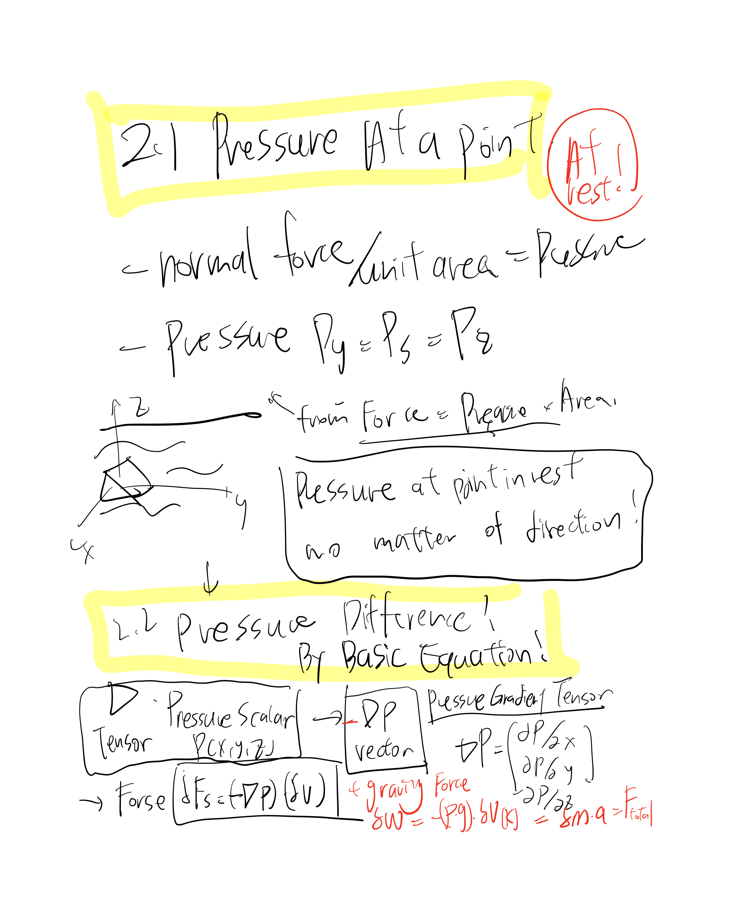
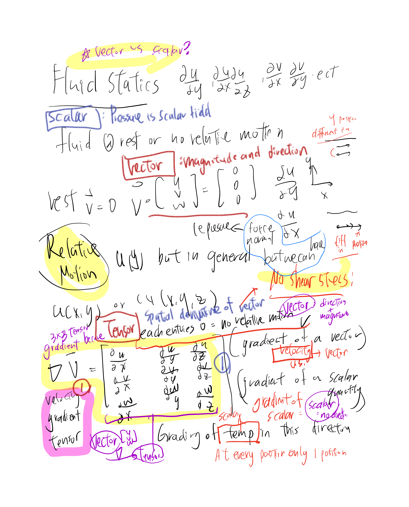
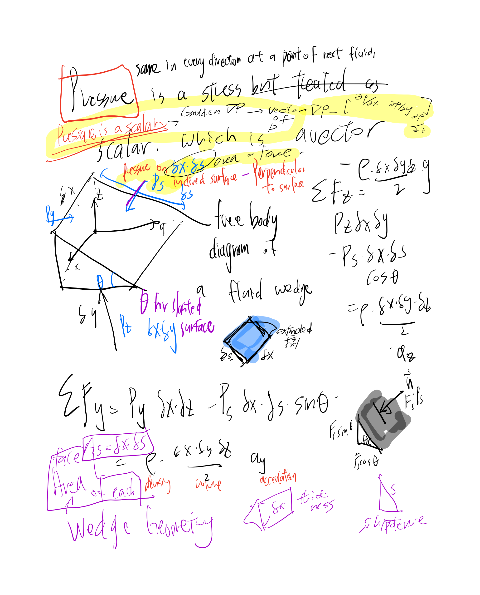
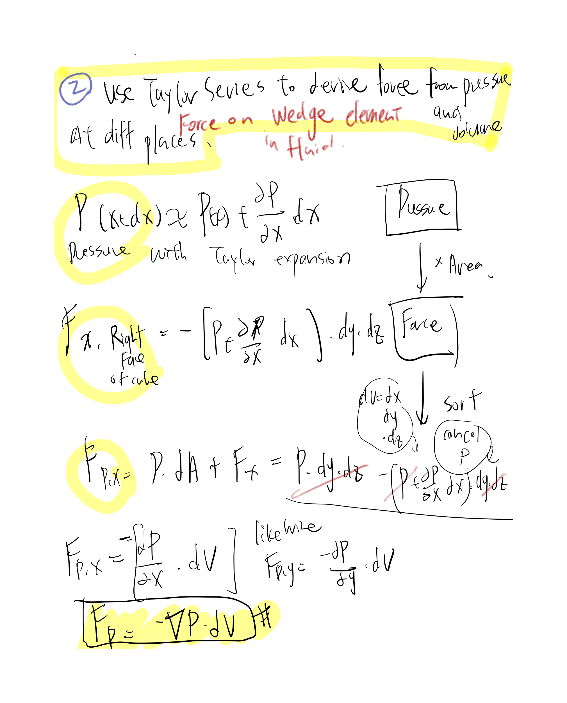
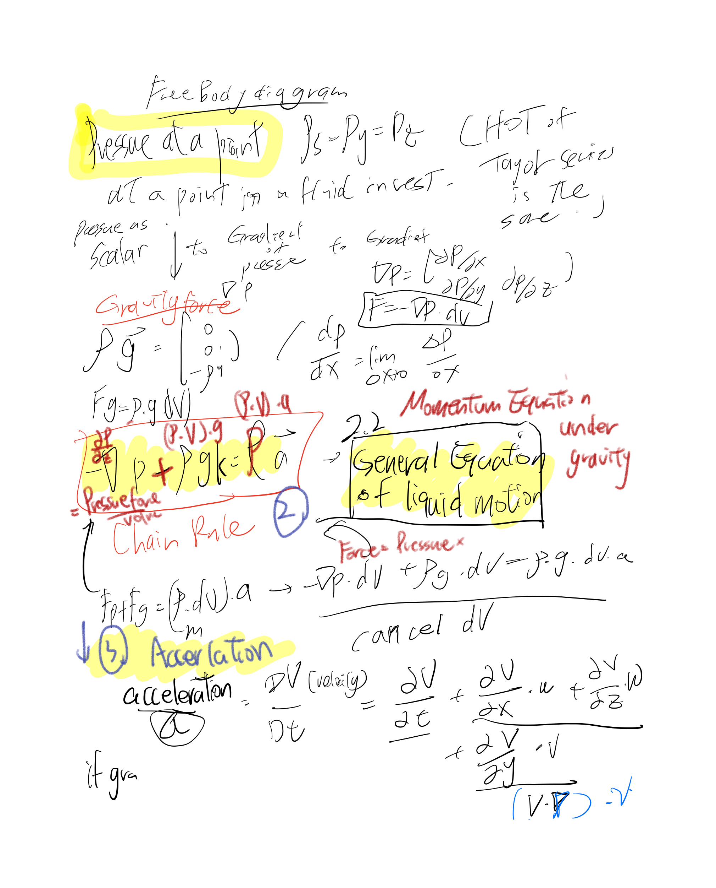
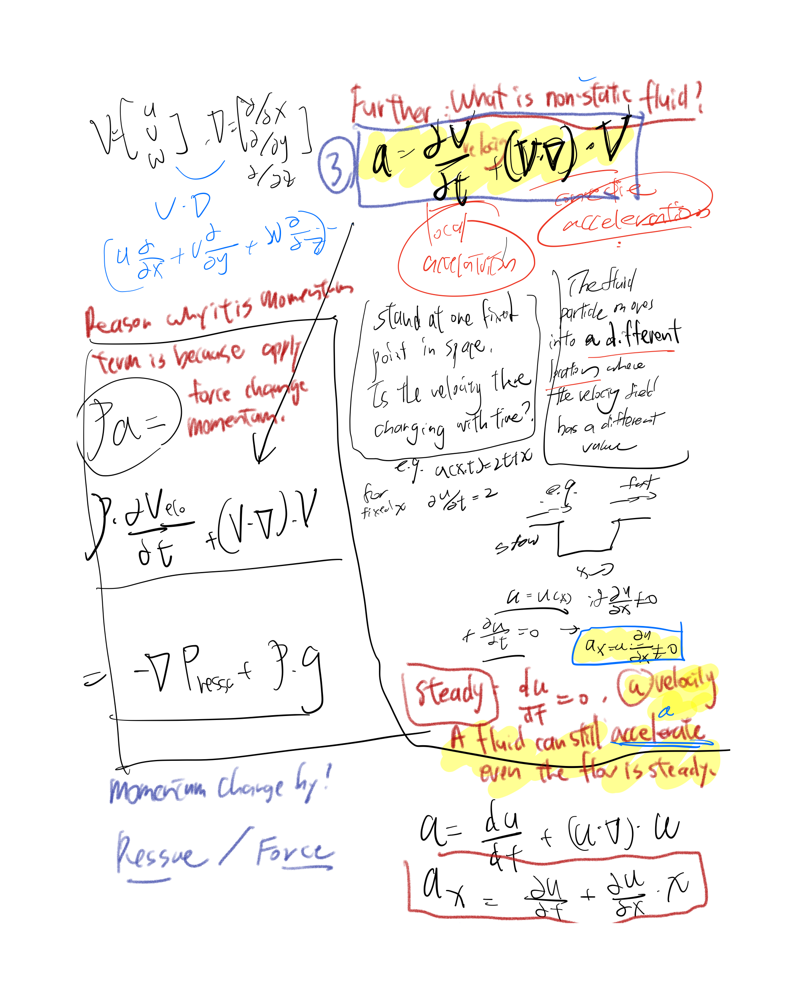
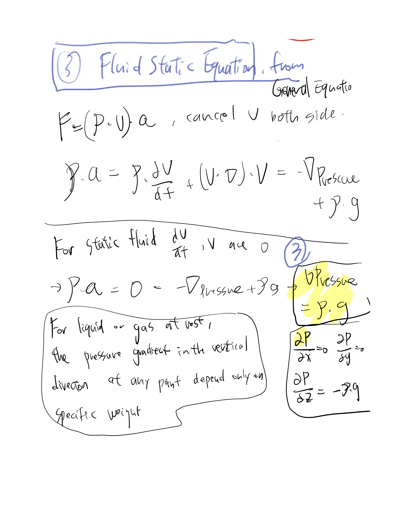
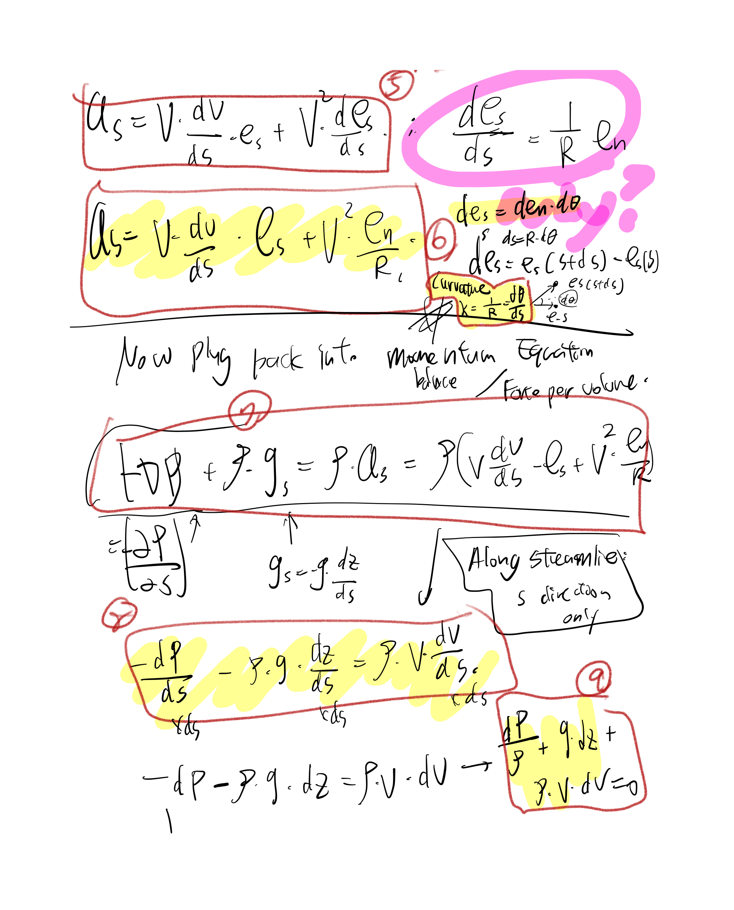
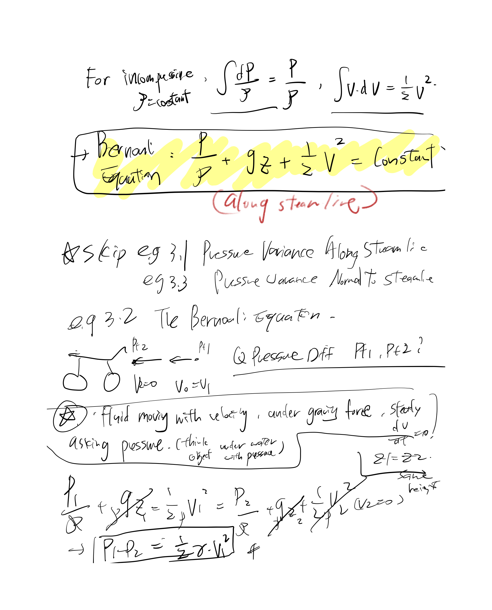
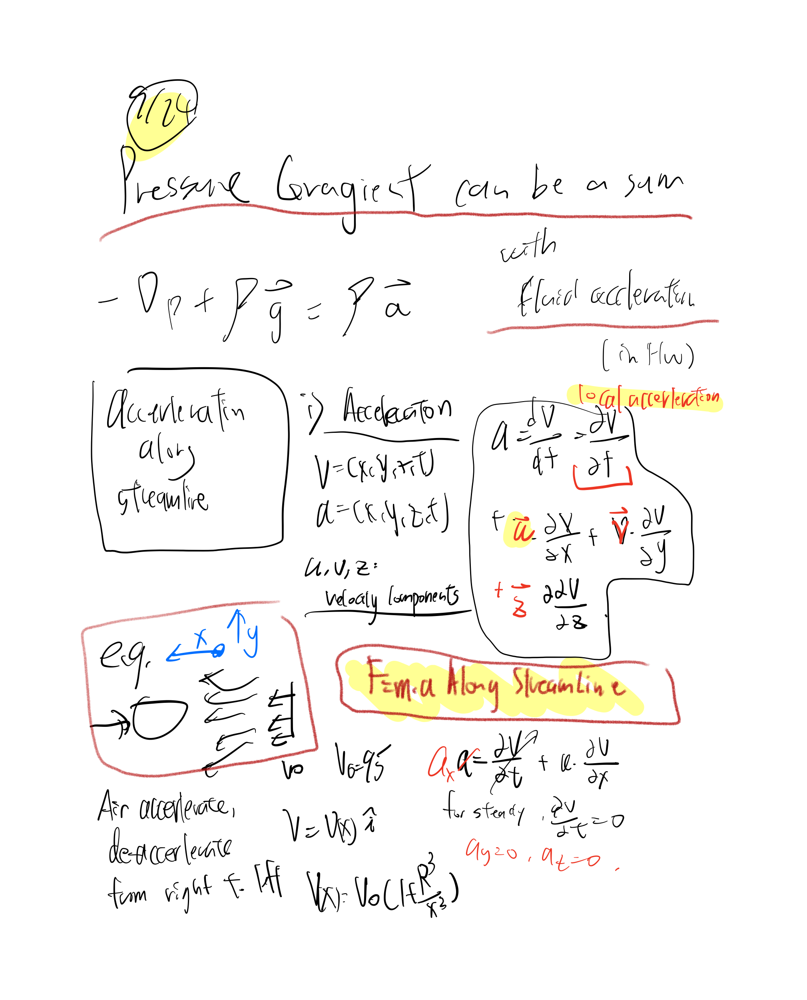

### HW2: Pressure at a pt, pressure field equation , pressure variation in a fluid a rest incompress v.s compress , manometry (piezometer, u-tube, inclined tube) , hydrostatic forece on a plane surface , pressure prism , buoyancy , flotation and stability 
- Known Manometer  Open surface with atomospheric pressure to derive connected piston pressure and force
- Question 2: If replace the constant density  by the pressure-dependent density, how to solve new Bernouli balance equation? > replace density into  conservation of momentum equation in the inviscid fluid before integration
$${\rho(P)=aP+b}$$
$$\[\int\frac{dP}{aP+b}+\int V\,dV+\int g\,dz=C.\]$$
### Q3> What pressure gradient is needed when the fluid changes speed?
### Q4> What pressure gradient is needed when the fluid changes direction?
- Question 4: normal pressure gradient (normal to the streamline) , with Different Curvature of Bended- Inner and Outer Aorta wall and normal vector of accerleration 
### HW3:

## Discussion- Different Approaches for Questions  
- Torque of Concentric-cylinder viscometer Inner cylinder (To know the torque transmitted through liquid to the inner cylinder) : Rotation -> Velocity Difference -> **Shear Stress / divide by area**-> **Shear Force** ->  Torque

# ME106 Flow Visualization Project
---

## Introduction

The goal of this project was to visualize airflow around an aircraft model and observe aerodynamic behavior that is ordinarily invisible during flight. A small aircraft model was mounted in a low-speed wind tunnel and exposed to approximately steady incoming airflow. Fog introduced upstream served as a flow tracer, making the motion of the surrounding air visible. In addition to producing an aesthetically interesting image, the experiment was intended to illustrate how the model redirects the incoming flow, alters flow near its surfaces, and potentially generates a downstream wake. The resulting image provides a qualitative basis for discussing several fundamental concepts in fluid mechanics.

---

## Methods

The experiment was conducted in a low-speed wind tunnel equipped with a viewing window. An aircraft model was mounted in the test section using a fixture that held it at a fixed position and angle of attack. The nominal freestream speed was approximately $40\text{ mph}$ ($17.9\text{ m/s}$), and the model was set to an angle of attack of $15^\circ$.

Fog was introduced upstream of the model to make portions of the airflow visible. As the fog was transported through the test section, its illuminated motion revealed changes in the flow direction around the aircraft. The image was captured with an iPhone through the tunnel's viewing window, using the available lighting to illuminate the fog. The photograph was analyzed qualitatively; it was not used to calculate local velocities or pressures.

The experimental arrangement is illustrated in Figure 1. The schematic shows the fog tube, aircraft model, supporting fixture, phone camera, and fan, as well as the model's angle of attack.

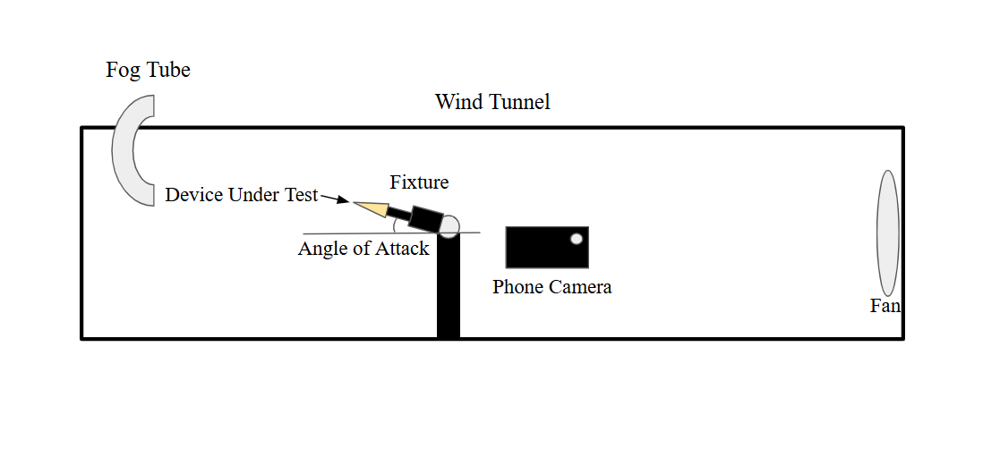  
*Figure 1: Schematic of the low-speed wind tunnel setup used for flow visualization. Fog is introduced upstream of the aircraft model, which is held at a fixed angle of attack by a fixture. A phone camera records the experiment, and a fan drives the airflow through the tunnel.*

---

## Results and Discussion

The experiment visualizes airflow around a stationary aircraft model at an approximately uniform upstream speed of $40\text{ mph}$ ($V_\infty = 17.9\text{ m/s}$) and an angle of attack of $15^\circ$. Fog introduced upstream traces selected regions of the flow around the model (Figure 2). The analysis proceeds from the characteristic flow regime (Reynolds number), to integral conservation of mass, and then to local acceleration and momentum conservation. The fog image is qualitative: it does not directly measure a local velocity field, pressure distribution, separation location, or aerodynamic force.

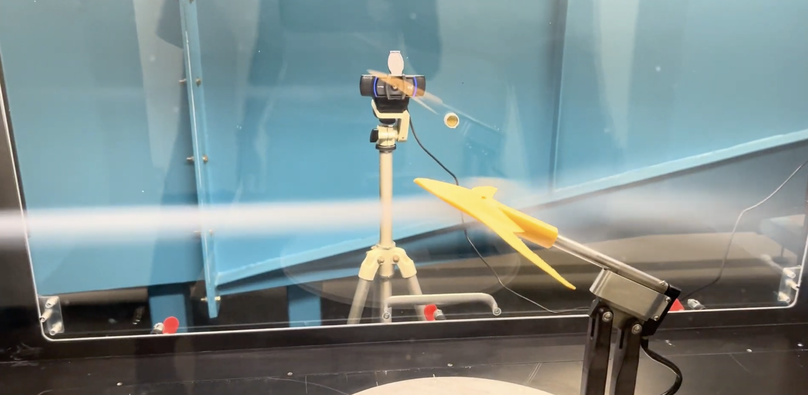  
*Figure 2: Fog visualization of the flow around a fixed aircraft model in a low-speed wind tunnel at approximately $40\text{ mph}$ and $15^\circ$ angle of attack. The visible tracer pattern indicates selected flow paths, not a measured velocity or pressure field.*

### Reynolds Number and Its Physical Significance

The chord-based Reynolds number compares characteristic inertial and viscous effects in flow around the wing:

$$Re_c = \frac{\rho V_\infty c}{\mu}$$

where $V_\infty$ is freestream speed, $c$ is the physical chord from leading to trailing edge (not its horizontal projection), $\rho$ is air density, and $\mu$ is dynamic viscosity. With measured $c = 60.2\text{ mm} = 0.0602\text{ m}$, and assumed room-temperature properties $\rho = 1.20\text{ kg/m}^3$ and $\mu = 1.81 \times 10^{-5}\text{ Pa}\cdot\text{s}$,

$$Re_c = \frac{(1.20\text{ kg/m}^3)(17.9\text{ m/s})(0.0602\text{ m})}{1.81 \times 10^{-5}\text{ Pa}\cdot\text{s}} \approx 7.14 \times 10^4$$

This Reynolds number provides a reproducible reference for the experimental condition even though the local velocity varies around the model. The large ratio indicates that inertia is important on the wing-chord scale. It does *not* imply that viscosity can be ignored in the thin boundary layer at the solid surface. At $15^\circ$ angle of attack, adverse pressure gradients may promote separation and modify the wake; the Reynolds number alone cannot determine whether or where separation, transition, or stall occurs.

### Conservation of Mass Using the Reynolds Transport Theorem

#### Why a Fixed Control Volume and Control Surface?

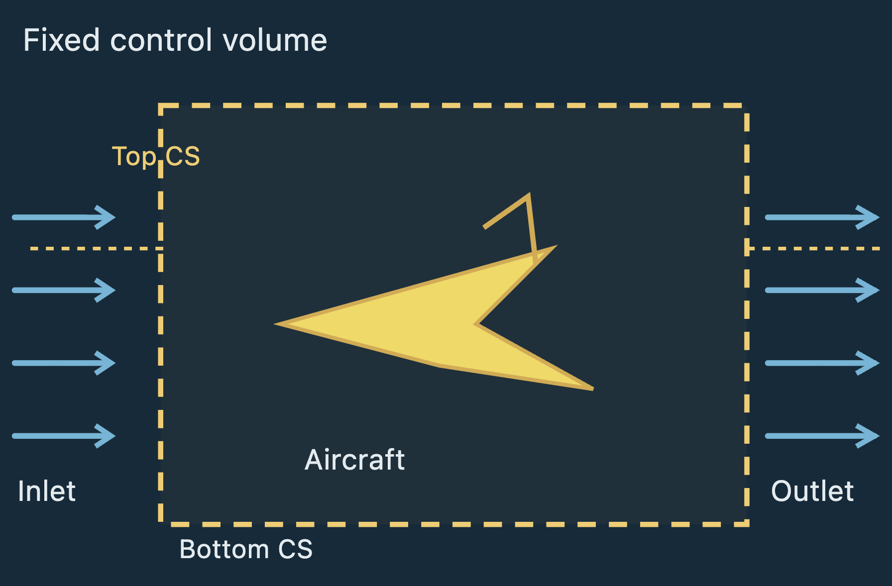  
*Figure 3: Illustrative two-dimensional section through a fixed control volume. Following every individual air particle would be inconvenient. Instead, we can choose a fixed region of space and examine the mass and momentum crossing its boundaries.*

Air passes continuously through the stationary test section. Therefore, a fixed (Eulerian) control volume (CV) is convenient: it contains air around the model while mass flows across the bounding control surface (CS). Choose an upstream cross section $A_1$ before the model, a downstream section $A_2$ containing the wake, the impermeable tunnel walls, and the impermeable aircraft surface as boundaries of the fluid CV. The outward normal vector $\mathbf{n}$ determines the sign of the flux: $\mathbf{V}\cdot\mathbf{n} < 0$ at the inlet and $\mathbf{V}\cdot\mathbf{n} > 0$ at the outlet. If the CV extends to the actual tunnel walls, there is no normal flow through those walls. The solid aircraft surface likewise has zero normal flow. Small fog injection mass is neglected.

#### Derivation from RTT

For an extensive property $B$ and specific property $b = B/m$, the Reynolds Transport Theorem for a fixed control volume is

$$\frac{dB_{\text{sys}}}{dt} = \frac{d}{dt}\int_{CV}\rho b\,dV + \int_{CS}\rho b(\mathbf{V}\cdot\mathbf{n})\,dA$$

For mass, $B = m$ and $b = 1$. Since the mass of a material system is conserved, $dm_{\text{sys}}/dt = 0$, so

$$0 = \underbrace{\frac{d}{dt}\int_{CV}\rho\,dV}_{\text{mass accumulation}} + \underbrace{\int_{CS}\rho(\mathbf{V}\cdot\mathbf{n})\,dA}_{\text{net outward mass flow}}$$

Under the additional assumption of *steady* flow through a fixed CV, the mass accumulation term is zero. Incompressibility permits density to be taken as approximately constant but, by itself, is not the reason the accumulation term vanishes. Therefore,

$$\int_{CS}\rho(\mathbf{V}\cdot\mathbf{n})\,dA = 0$$

Divide the closed CS into inlet, outlet, tunnel walls, and the aircraft surface:

$$0 = \int_{A_1}\rho(\mathbf{V}\cdot\mathbf{n})\,dA + \int_{A_2}\rho(\mathbf{V}\cdot\mathbf{n})\,dA + \underbrace{\int_{CS_{\text{walls}}}\rho(\mathbf{V}\cdot\mathbf{n})\,dA}_{=0} + \underbrace{\int_{CS_{\text{aircraft}}}\rho(\mathbf{V}\cdot\mathbf{n})\,dA}_{=0}$$

For approximately uniform incoming flow aligned with $+x$, the inlet outward normal is $-\mathbf{i}$, hence $\mathbf{V}_1\cdot\mathbf{n} = -V_\infty$. At the downstream plane $\mathbf{n} = +\mathbf{i}$, and $\mathbf{V}_2\cdot\mathbf{n} = u_2(y,z)$. Substitution gives

$$0 = -\rho V_\infty A_1 + \rho\int_{A_2}u_2(y,z)\,dA$$

or

$$\dot{m}_{\text{in}} = \rho V_\infty A_1 = \rho\int_{A_2}u_2(y,z)\,dA = \dot{m}_{\text{out}}$$

#### Conditional Mass-Flow Estimate and Its Meaning

If the reported width $W = 4.0\text{ m}$ and height $H = 1.8\text{ m}$ are the *actual flow cross-section dimensions*, and if $17.9\text{ m/s}$ is the cross-sectionally uniform inlet speed, then

$$A_1 = WH = (4.0)(1.8) = 7.2\text{ m}^2$$

$$Q_{\text{in}} = V_\infty A_1 = (17.9)(7.2) \approx 128.9\text{ m}^3\text{/s}$$

$$\dot{m}_{\text{in}} = \rho Q_{\text{in}} = (1.20)(128.9) \approx 154.7\text{ kg/s}$$

This value is *conditional*, not a verified measured flow rate. If the quoted tunnel dimensions describe the overall facility rather than the test-section air passage, the appropriate inlet area must be obtained before using this numerical result.

Even when $\dot{m}_{\text{in}} = \dot{m}_{\text{out}}$, the downstream velocity profile need not be uniform: lower streamwise velocity in a wake can be accompanied by higher velocity elsewhere in the cross section. Without a measurement of $u_2(y,z)$, the outlet profile cannot be calculated. The mass balance is nevertheless valid under its assumptions.

### Fog Streaklines, Material Derivative, and Streamline Curvature

In the Eulerian description, velocity is a field $\mathbf{V}(x,y,z,t)$, whereas the Lagrangian description follows a particle position $\mathbf{x}_p(t)$ satisfying

$$\frac{d\mathbf{x}_p}{dt} = \mathbf{V}\left(\mathbf{x}_p(t),t\right)$$

If fog is continuously released from a localized upstream source, its visible filament is a *streakline*. For ideal tracers in steady flow, streaklines, particle pathlines, and streamlines coincide; they need not coincide in unsteady wake motion.

A steady freestream does not imply zero particle acceleration. The material derivative is

$$\frac{D\mathbf{V}}{Dt} = \underbrace{\frac{\partial\mathbf{V}}{\partial t}}_{\text{local acceleration}} + \underbrace{(\mathbf{V}\cdot\nabla)\mathbf{V}}_{\text{convective acceleration}}$$

For steady, two-dimensional flow with $\mathbf{V} = u\mathbf{i} + v\mathbf{j}$,

$$\frac{Du}{Dt} = u\frac{\partial u}{\partial x} + v\frac{\partial u}{\partial y}$$

$$\frac{Dv}{Dt} = u\frac{\partial v}{\partial x} + v\frac{\partial v}{\partial y}$$

As flow turns around the aircraft, the velocity vector can change direction even without a change in speed. For a curved streamline with local radius of curvature $R$,

$$a_n = \frac{V^2}{R}$$

For locally inviscid flow away from the wall, Euler's normal momentum equation (with $n$ pointing away from the center of curvature) yields

$$\frac{\partial p}{\partial n} = \rho\frac{V^2}{R}$$

Steady, incompressible, inviscid Bernoulli flow with negligible elevation change also satisfies, *along a streamline*,

$$p + \frac{1}{2}\rho V^2 = \text{constant}$$

Thus flow turning and changes in local speed are linked to pressure gradients. However, $V(x,y,z,t)$, its spatial gradients, and the local streamline radius $R$ were not measured. Accordingly, the acceleration and pressure-gradient equations explain the qualitative physics but cannot be evaluated numerically from this photograph alone. Bernoulli's relation should not be applied uncritically across separated or strongly dissipative flow.

### Conservation of Linear Momentum and Aerodynamic Forces

Using $B = m\mathbf{V}$ and $b = \mathbf{V}$ in RTT and applying Newton's second law,

$$\sum\mathbf{F}_{\text{ext}} = \frac{d}{dt}\int_{CV}\rho\mathbf{V}\,dV + \int_{CS}\rho\mathbf{V}(\mathbf{V}\cdot\mathbf{n})\,dA$$

For steady flow in the fixed CV,

$$\sum\mathbf{F}_{\text{ext}} = \int_{CS}\rho\mathbf{V}(\mathbf{V}\cdot\mathbf{n})\,dA$$

The external forces on the *fluid* include pressure and viscous tractions, the force exerted by the aircraft on the air, and tunnel-wall forces. Unlike their zero *mass* flux, the solid surfaces can exert nonzero forces. The measured or modeled momentum-flux difference alone therefore does not generally give the aircraft force unless other contributions have been evaluated or shown negligible.

For streamwise $x$-momentum and vertical $y$-momentum, respectively,

$$\sum F_x = \int_{CS}\rho u(\mathbf{V}\cdot\mathbf{n})\,dA$$

$$\sum F_y = \int_{CS}\rho v(\mathbf{V}\cdot\mathbf{n})\,dA$$

The reaction of the fluid on the aircraft provides aerodynamic drag and lift. Under additional assumptions appropriate to a far-wake survey (including recovered static pressure, a suitable control surface, and negligible unaccounted fluxes or wall forces), drag may be approximated from a downstream momentum deficit:

$$D \approx \rho \int_{A_{\text{wake}}} u_2(y,z) \left[ V_\infty - u_2(y,z) \right] dA$$

This is *not* valid for an arbitrary measurement plane without checking those assumptions. Actual evaluation requires a spatially resolved wake velocity profile and, where relevant, pressure and surface-force corrections.

An alternative drag representation is

$$D = \frac{1}{2}\rho V_\infty^2 S C_D$$

where $S$ is the specified reference area and $C_D$ is the drag coefficient referenced to that same area. Using the present assumed air properties,

$$q_\infty = \frac{1}{2}\rho V_\infty^2 \approx 192\text{ Pa}$$

giving

$$D \approx (192\text{ Pa}) S C_D$$

For a rectangular wing with planform reference area $S = bc$, the wingspan $b$ is needed; $C_D$ is also unknown. Thus no experimental drag or lift value can be inferred from the fog photograph.

### Boundary Layer, Possible Separation, and Wake

The no-slip condition makes the air velocity equal to the fixed model's surface velocity at the wall, causing a viscous boundary layer to develop. Pressure gradients along the wing can accelerate or decelerate the external flow. If an adverse pressure gradient is sufficiently strong, the near-wall flow may separate, producing an unsteady wake with a local momentum deficit and mixing. The $15^\circ$ angle of attack and chord Reynolds number make these effects important to consider, but the photograph does not prove a particular separation point, vortex pattern, or stall condition.

### Measurement Limitations and Parameters Still Needed

| Analysis | Status | Missing information or qualification |
| :--- | :--- | :--- |
| **Chord Reynolds number** | Estimated | Uses assumed $\rho$ and $\mu$; measure temperature and pressure for refined properties. |
| **Mass flow rate** | Conditional | Verify $4.0 \times 1.8\text{ m}^2$ is the test-section flow area and verify inlet velocity uniformity. |
| **Material acceleration** | Qualitative | Local velocity field and spatial gradients; time-resolved velocities if the flow is unsteady. |
| **Streamline curvature** | Qualitative | Local velocity magnitude $V$ and radius of curvature $R$ from calibrated images or a velocity-field survey. |
| **RTT momentum, lift, drag** | Qualitative | Inlet/outlet or wake velocity profiles, pressure distributions and relevant surface forces; account for lateral fluxes. |
| **Drag-coefficient method** | Not calculable | Reference area $S$ (including missing wingspan $b$ if $S = bc$) and compatible $C_D$. |

---

## Conclusions

At an approximately $40\text{ mph}$ freestream speed and $15^\circ$ angle of attack, fog illuminated selected portions of the air moving around a fixed aircraft model. Based on an assumed room-temperature air density and viscosity, the chord Reynolds number is approximately $7.14 \times 10^4$, emphasizing the importance of inertial effects while retaining viscous boundary-layer phenomena.

The Reynolds Transport Theorem shows that, for a steady fixed control volume bounded by impermeable walls, incoming and outgoing mass flow rates are equal even when the outlet velocity is nonuniform. The material derivative relates the deflection of fluid paths to convective acceleration, and the momentum form of RTT relates changes in momentum flux and external forces to aerodynamic loading.

These equations explain what the fog visualization represents, while measured velocity profiles, curvature, pressures, wing reference area, and forces would be needed to quantify acceleration, lift, or drag.
